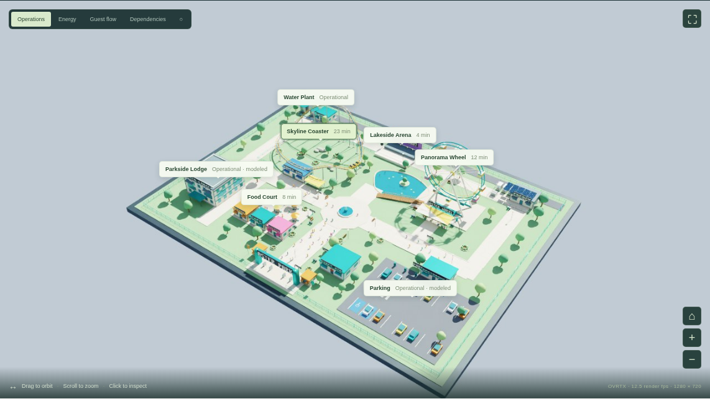
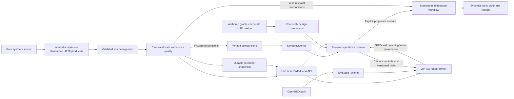

# Aster Park — an Omniverse digital-twin proof of concept

An interactive theme park combining procedural OpenUSD geometry, **NVIDIA OVStage + OVRTX GPU rendering**, a browser operations console, and synthetic Python/SQLite operational systems.

**Review progress:** [Status and render gallery](docs/progress.md) · [Original project prompt](docs/project-prompt.md) · [Asset index](assets/README.md)

[Illustrated project deck (PDF)](docs/project-concept.pdf) · [Five-minute walkthrough](docs/demo-walkthrough.md) · [Integration roadmap](docs/integration-roadmap.md) · [Editable Blender scene](assets/park.blend)

**Watch the presentation:** [3½-minute GPU application demo](docs/video/README.md) — navigation, incident response, utilities, source quality and replay, with English captions.



[Validation and application screenshots](docs/validation.md)

## Ongoing development

The [FOX-inspired research and decision map](docs/research/fox-theme-park.md)
now has a working Decision Lab: frozen observations, 15–120 minute comparisons,
do-nothing and simple-rule alternatives, resource constraints, and
[durable evidence](docs/planning-evidence.md). A separate
[maintenance workflow](docs/bounded-maintenance-workflow.md) turns a current incident
or saved comparison into an explicit, retry-safe synthetic work order. Dispatch
leaves a closed ride closed; it is not evidence of repair.

[Spatial design queries](docs/spatial-api.md) compare an audited partial path graph
with a separate [dining connection proposal](docs/dining-design-variant.md).
The browser compares both designs, route constraints, and
[matched native RTX closeups](docs/circulation-native-rendering.md#actual-native-comparison).
A [read-only external weather preview](docs/external-weather-preview.md) keeps
external forecasts distinct from synthetic park observations. These services do
not replace ERP, CMMS, ride controls or calibrated engineering models.

The eight-hour evaluation started **19 October 2026 at 19:47 UTC** and remains
in progress. [Run status](docs/experiments/2026-10-19-run-status.md) records its
scope and interruptions. [Independent reviews](docs/reviews/) and an
[independent policy stress experiment](docs/experiments/food-service-policy-stress.md)
include unfavorable results. Actual L40/OVRTX/browser acceptance at `afa84a1`
passed [six incident-workflow checks](docs/images/fox-cycle-20261019/gpu-incident-afa84a1/report.json)
and [seven spatial comparison checks](docs/images/fox-cycle-20261019/gpu-spatial-afa84a1/report.json).
Earlier recovery/staleness tests and all exact source scopes remain in the
[progress gallery](docs/progress.md).

## What you can explore

- A fenced park with an animated roller coaster and Ferris wheel, trees, lake, paths, food court, show venue, utilities, hotel and parking.
- An actual OVRTX image viewport with orbit/zoom/focus and native geometry picking. Asset clicks resolve USD prim paths to database records.
- Twelve identified assets and ten synthetic domain feeds covering rides, ticketing, queues, counts, maintenance, ERP stock, workforce, buildings, utilities and weather.
- Seven scenarios: normal operation, ride closure, show surge, heatwave, power fault, water leak and food demand. Compare frozen what-if branches with explicit assumptions, then save or reopen the evidence.
- Current-incident maintenance proposals with expiry, relevant-state rechecks, durable retry identity and work-order readback.
- Read-only baseline/design path queries with explicit unreachable results and source hashes.
- Audited synthetic actions, telemetry history, dependencies, staffing, inventory and work orders. A closed or faulted ride stops its animation.

## Architecture



[Detailed implemented data flow and ownership](docs/implemented-architecture.md)
· [Run independent synthetic source producers](docs/synthetic-producers.md)

The browser receives GPU-rendered images and draws data annotations over them. Camera controls and native picking execute on the GPU server. Protocol names such as OPC UA, MQTT and ERP REST identify **future integration boundaries**: the implemented domain feeds are synthetic HTTP APIs. ERP and CMMS remain systems of record in the proposed real deployment; the twin provides shared spatial context and operational coordination.

## Run the complete application

Tested on Linux, Python 3.10, NVIDIA L40 (48 GB), driver 570.158.01. OVRTX and OVStage are pre-release SDKs; exact tested builds are pinned. Install the NVIDIA driver and provide a graphics-capable GPU/Vulkan environment before starting the renderer. See the [OVRTX documentation](https://nvidia-omniverse.github.io/ovrtx/) for platform requirements.

```sh
python3 -m venv .venv
.venv/bin/pip install -r requirements-backend.txt -r requirements-renderer.txt
.venv/bin/python scripts/start.py
```

Open **http://127.0.0.1:8100**. The launcher starts the backend and renderer independently, writing PIDs and logs to `runtime/`. The first renderer startup can spend several minutes compiling shaders. The render service binds to loopback port 8091; the gateway proxies frames, controls and picks.

For a remote GPU, forward the gateway using your authenticated SSH connection:

```sh
ssh -L 18765:127.0.0.1:8100 user@gpu-host
# Open http://127.0.0.1:18765 on your local machine.
```

This demo has no application login and shares one camera and simulator across viewers. Keep it behind authenticated access. It is not a public multi-user deployment.

### Backend-only exploration

```sh
.venv/bin/pip install -r requirements-backend.txt
.venv/bin/python -m uvicorn main:app --host 127.0.0.1 --port 8100
```

The operations console works without a GPU; its viewport reports the renderer unavailable. API documentation is at `/docs`. Override `PARK_DB` to select a database file. If changing the backend port, set `PARK_API_URL` for the renderer.

### Stop the demo processes

Run `.venv/bin/python scripts/stop.py` (or append `renderer` / `backend`). The script verifies the recorded process identity and waits for shutdown before a restart. Stop the GPU instance through your compute provider when it is no longer needed. Runtime databases, logs, credentials and downloaded SDKs are excluded from Git.

## Rebuild and extend

- [Scene generation and Blender workflow](docs/scene.md): generated USD, ride paths, material manifest, and editable `.blend`. Blender 4.5.3 LTS was used; older distributions may omit USD import support.
- [Backend contracts and limitations](docs/backend.md): domain feeds, deterministic simulation, scenarios and actions.
- [Frontend behavior](docs/frontend.md): renderer controls, projected annotations, interaction and browser validation.
- [Deck source and research](docs/deck-source/README.md): regenerate the ten-page PDF from editable Python vector illustrations.
- [Integration roadmap](docs/integration-roadmap.md): candidate connectors, aggregation architecture, pilot phases and how to measure added value.

```sh
.venv/bin/python -m pytest -q tests/test_backend.py
.venv/bin/python modeling/animate.py
```

Keep USD modeling tools (`usd-core`) in a separate environment from the live rendering process. The renderer uses the standalone OVStage/OVRTX SDKs, not a Kit application or browser 3D substitute.

## Scope

This is a working demonstration with illustrative data and heuristic scenario responses. It contains no calibrated crowd, safety, ride-engineering or financial simulator, no embedded LLM agent, and no physical controls. Independent development agents review the project; its recurring HTTP operators and numerical planners are deterministic programs. Scenario metrics explain workflows; they do not substantiate savings forecasts. The queue average excludes closed attractions, and summed monitored water flow includes circulation.

Native SDKs are installed separately under NVIDIA's licenses; their binaries and reference source are not redistributed here. Park geometry, illustrations and application code were created for this project. Publication does not imply NVIDIA endorsement.

Inspiration and references: [NVIDIA FOX](https://blogs.nvidia.com/blog/factory-operations-fox-blueprint-ai-brain/), [OVRTX](https://github.com/NVIDIA-Omniverse/ovrtx), [OVStage](https://github.com/NVIDIA-Omniverse/ovstage), [deck research sources](docs/deck-source/sources.md).
