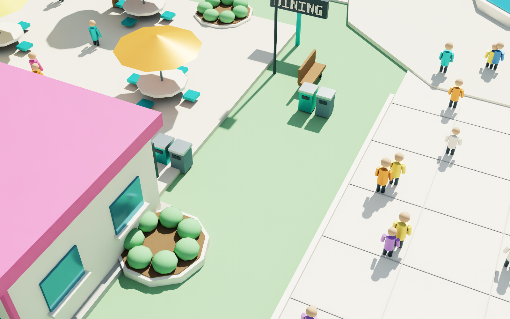
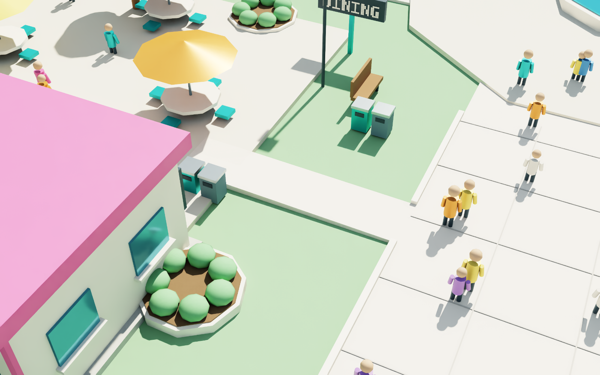

# Native rendering of spatial design comparisons

`scripts/render_circulation.py` renders an isolated authored stage with OVStage and OVRTX. It does not attach to the live park app or include current telemetry. Its default invocation preserves the original **baseline diagnostic overview and plan-view** captures.

For an inspectable before/after comparison, render the baseline and dining variant with the same close-up camera and no diagnostic lines:

```bash
python scripts/render_circulation.py --output runtime/dining-before --view dining-closeup --overlay none
python scripts/render_circulation.py --output runtime/dining-after --variant dining_connection --view dining-closeup --overlay none
```

Use separate output directories so the original capture remains reviewable. Both calls use eye `(-1, -43, 17)`, target `(-9, -26.4, 0.3)`, a 42 mm focal length, and 1600 × 1000 output. The connector, old/new curb, terrace edge, bins, and adjacent furniture occupy the same framing. The renderer does not adjust the camera between designs to make an outcome look better.

Optional views are `overview`, `plan-view`, `dining-closeup`, and `all`. Omitting `--view` retains the original two-view behavior. `--overlay diagnostic` is the default; `--overlay none` produces a clean scene comparison. For example:

```bash
python scripts/render_circulation.py --output runtime/dining-diagnostic --variant dining_connection --view all --overlay diagnostic
```

For the design variant, the script regenerates the diagnostic overlay from the **variant graph** in the output directory. It does not reuse the baseline's missing-food-connection overlay. Composition order, strongest first, is diagnostic overlay when enabled, dining physical-design layer when selected, then unchanged baseline park. A new composition root explicitly declares meters and Z-up.

Before any render, the script uses the spatial service's identity checks to verify graph, scene, geometry, design-layer and evidence declarations. The report records exact script/helper hashes, ordered source-layer hashes, graph identity, each saved composition-source hash, camera settings, SDK versions, and actual rendered image hashes. Original report fields such as `scene_sha256`, `overlay_sha256`, `graph_sha256`, `captures`, `complete`, and cleanup errors remain available.

A completed native report has `mode: "native_render"`, image entries in `captures`, `native_rendered: true`, and `complete: true` after rendering and cleanup succeed. Failed or partial work must not be described as a successful comparison.

## CPU preparation and USD syntax checks

`--prepare-only` writes identity-bound composition sources without importing OVStage, OVRTX, NumPy, or a GPU renderer:

```bash
python scripts/render_circulation.py --output runtime/dining-prepare --variant dining_connection --view all --prepare-only
```

Its report explicitly has `mode: "cpu_preparation_only"`, `native_rendered: false`, `complete: false`, and no image captures. Successful preparation is not GPU evidence.

In an environment with `usd-core`, open the generated `*-composition.usda` files with `Usd.Stage.Open`. Check the root's Z-up/meters metadata, the camera transform, `/Render/Camera/LdrColor`, and the baseline/design curb state. The variant must deactivate `/World/Park/LANDSCAPE/PathCurb` and include `/World/Park/DINING_CONNECTION_DESIGN/GradedPaving`; the baseline must retain the original curb and omit the design geometry.

Five generated compositions were opened successfully with USD 26.8: baseline clean close-up, design clean close-up, and all three design diagnostic views. Their camera matrices match for the before/after close-up, and the stronger design override applies correctly. Eight CPU tests cover the CLI/report distinction, composition order, overlay source, unchanged assets, camera basis, and original defaults. Actual L40/OVStage/OVRTX before-and-after execution subsequently completed on 19 October at 20:42–20:43 UTC. Both images were visually inspected: the same view shows the original grass gap and continuous curb, then the new graded connector and curb opening. Neither capture includes live telemetry.

A visible connector supports a geometry review. It does not establish practical passing clearance, crowd capacity, accessibility certification, live operating performance, or real-world safety.

## Actual native comparison

| Unchanged baseline | Separate dining proposal |
|---|---|
|  |  |

[Baseline native report](images/fox-cycle-20261019/dining-design/baseline/report.json) ·
[Design native report](images/fox-cycle-20261019/dining-design/dining_connection/report.json)

Both runs used OVStage `0.3.0.1791986420`, OVRTX `0.6.0.1791947691`,
60 frames and identical 1600 × 1000 camera settings. The reports record exact
scene, graph, layer, script, composition and image hashes; downloaded bytes were
checked against their remote hashes. Each native stage was detached and destroyed
without reported cleanup errors. They ran independently of the continuously
observed operations renderer. The input files were copied to an isolated render
source directory, using the unchanged committed baseline assets; this evidence
is not acceptance of a newly deployed interactive application release.
