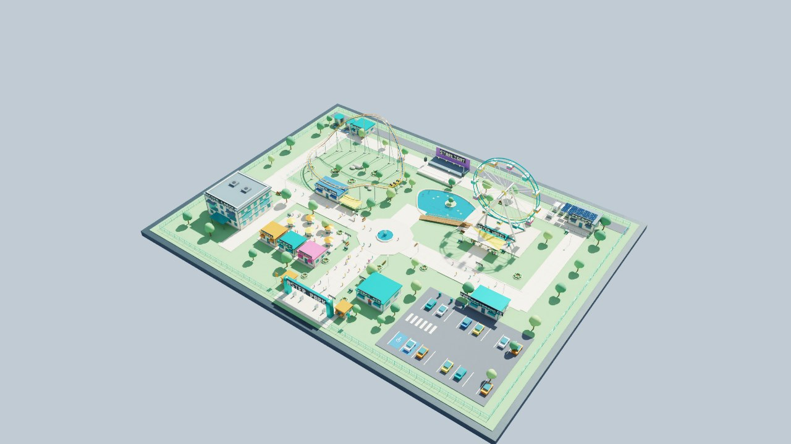

# Eight-hour experiment status

This is a running experiment, not a completed eight-hour result.

| Track | Actual start (UTC) | Planned finish (UTC) | Source |
| --- | --- | --- | --- |
| Isolated API exercise | 2026-10-19 19:47:34 | 2026-10-20 03:47:34 | Fixed `d3dca3d20612d3d09ed1acb680683a990cbd51ba` |
| GPU read-only observation | 2026-10-19 19:47:33 | 2026-10-20 03:47:33 | Observer fixed at `d3dca3d`; deployment revisions recorded per sample |

The API exercise uses a separate database and process supervisor. It repeats HTTP
checks every five minutes, including explicit non-benefit cases, degraded inputs,
replay isolation and durable retries. Any paused interval remains part of the wall
clock and is reported separately from mutation cycles.

The GPU observer checks health and exact downloaded JPEG provenance every 30
seconds and saves a frame approximately hourly. It observes the development
renderer across deployments. One connection-refused sample at 19:49:33 UTC
coincided with the deliberate deployment from `20f0ca8` to `d3dca3d`; that failure
remains in the record. This is an observed development-session availability test,
not an uninterrupted-production-uptime claim.

First-cycle API checks passed; subsequent counts remain in the live runtime ledger
until a dated checkpoint or final report is published. Both tools are deterministic
clients, not an LLM agent embedded in the application. Independent coding agents
review their methods and results.

The developer will stop temporary Horde compute after final collection while
preserving the project workspace. Approximately 05:47 CEST is the target finish,
with collection and shutdown following it.

## Intermediate checkpoint — 19 October, approximately 20:40 UTC

The fixed-source API run reported 11 completed cycles, zero failures and no paused
intervals at 3,121.672 elapsed seconds. The GPU observer reported 105 samples, one
failed sample, a maximum health-request latency of 42.57 ms and maximum observed
frame age of 0.140393 seconds at 3,120.993 elapsed seconds. These are intermediate
counts, not eight-hour results.

The application was deliberately redeployed from `d3dca3d` to `64c8bfa` at
20:34:38–20:34:40 UTC. The 30-second observer did not sample an additional failure;
this does not establish uninterrupted availability between samples. The fixed
API run continues on its original source. Separate GPU browser acceptance of
`64c8bfa` passed twelve workflow checks, including actual lost responses, reload
recovery, source staleness and duplicate-work-order prevention.

A GPU resource sampler began later, at 20:10:39 UTC, recording once per minute.
It therefore cannot support a full eight-hour resource-usage claim. Independent
static native captures may temporarily add another rendering process; those are
development activity, not load attributable to the application alone.

## Independent offline checkpoint — 19 October, 21:03 UTC

The [reconciled ledger analysis](run-analysis/interim-2105/analysis.md) contains
16 full fixed-source API cycles (161 checks including startup), zero failures and
no pauses. The separately captured GPU prefix contains 145 observations and the
same one failed sample. Its four observed application revisions are retained;
the two snapshots were captured at different times. Neither track is complete.

The [timeline](run-analysis/interim-2105/timeline.svg) marks source transitions
and the failed sample. The [offline analyzer](run-analysis.md) fingerprints inputs,
checks summary/journal agreement, reports gaps and refuses to produce a final
eight-hour deck summary from incomplete evidence. Six analyzer boundary tests
passed; these are separate from application acceptance.

The GPU application was deployed to `afa84a17d6cc282ed2aa4003743d62770644ea48`
at 20:52:09–20:52:12 UTC. Independent browser acceptance then passed six direct
incident checks and seven spatial-design checks. A short actual-browser video
capture began at 21:04:15 UTC; it is development activity on the observed GPU
session and does not change the isolated fixed-source API test.

## Two-hour checkpoint — 19 October, 21:48 UTC

[Reconciled analysis](run-analysis/checkpoint-2h/analysis.md) ·
[Independent checkpoint review](run-analysis/checkpoint-2h/review.md) ·
[Timeline](run-analysis/checkpoint-2h/timeline.svg).

Fresh copies contain **25 full API cycles / 251 checks / zero failures** at
7,273.226 elapsed seconds, and **243 GPU observations / one failure** at
7,272.243 seconds. Both producers remain incomplete. Summary/journal counts agree,
and neither copy changed during its individual read. The snapshots are separate
live-prefix captures, not one atomic cross-system snapshot.

The v2 schedule diagnostic is adequate for these observed prefixes. All scheduling
gaps remain recorded: maximum 0.366679 s for API cycles and 0.010451 s for GPU
observations, within the declared two-second bookkeeping/poll allowance. This
describes the sampling schedule, not continuous uptime or continuous functional
execution. No pauses were recorded. The four GPU source revisions and the original
connection-refused sample remain visible.

The unchanged native JPEG was captured at 21:47:35 UTC by observer sample 240.
Its [observation record](../images/fox-cycle-20261019/observation-2h/observation.json)
retains the exact image hash, headers and verified source identity. A single frame
does not establish continuous rendering rate or ride motion.
