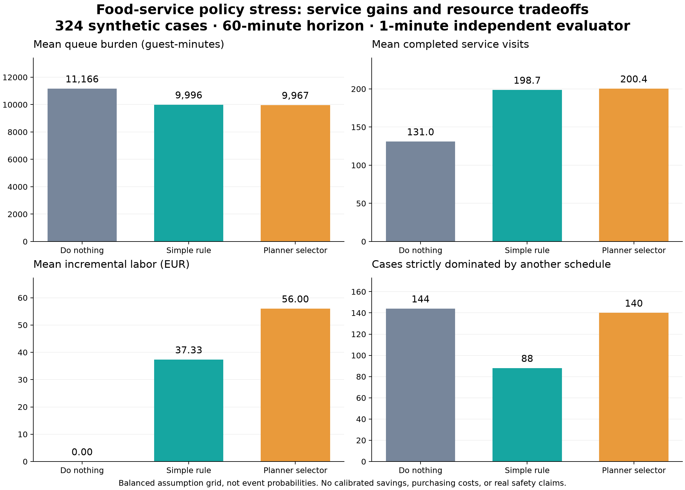

# Independent synthetic food-service policy stress test

## Protocol declared before evaluation

This experiment asks whether the new planner adds a measurable modeled benefit over
a simple operational rule, and when its choices become unnecessary or worse. It is
an independent **one-minute food-service queue evaluator**, not a second invocation
of the planner engine. The client imports no planner/backend modules. All inputs,
arrivals, effects and delays remain synthetic. There are no withheld real park days,
so this is not empirical forecast validation or proof of real operational value.

The input API is an isolated gateway on port 18140. The eight-hour experiment on
18120 is neither mutated nor restarted. Both use a frozen source release; the
stress evaluator records the exact source identity returned by the isolated API.

### Initial observations and policies

Start with an observed synthetic food-rush condition. Test three predefined
variants: its original low stock and two-person staffing gap; the same low stock
with staffing coverage restored; and full inventory with the original staffing
gap. Variants enter through the existing synthetic ERP/workforce ingestion APIs.
The planner receives the frozen canonical revision and `scenario: normal`, meaning
continue the already observed incident without applying a second prospective shock.

Candidate action schedules are fixed before outcomes are computed:

- **Do nothing:** no additional assignment or order.
- **Replenish:** order 300 units at minute zero, capped by stock capacity on receipt.
- **Staff:** assign two qualified reserve staff at minute zero.
- **Both:** make those two requests at minute zero.

Policies compared are doing nothing, the simple **stock-and-coverage rule**, and
selection from the planner's feasible shortlist. The rule orders stock if current
stock is below initial backlog plus expected nominal arrivals over 60 minutes;
it assigns two staff when observed on-duty staff is below required coverage.
Nominal arrivals are 90% of observed hourly service capacity. The planner selector
uses its explicit preferred baseline when available; otherwise it chooses the
feasible shortlisted candidate with smallest predicted queue guest-minutes, then
smallest incremental labor cost, then fewest actions, then stable candidate ID.
This tie-breaking is declared operational preference, not a business utility model
or proof that the selected action is optimal for a real park.

### Independent one-minute evaluator

The model has one FIFO fluid queue, one stock balance, and one service station.
Initial backlog is posted queue minutes times observed service capacity per minute;
this inference is an approximation and not a measured queue count. Each minute:

1. Deliver an order or activate staff if its assumed delay has elapsed.
2. Add that minute's arrivals to the queue.
3. Serve up to available one-minute capacity, queued visits and stock.
4. Subtract one stock unit per completed service visit; retain all unserved visits.

Queue guest-minutes use the trapezoid between the queue immediately before arrivals
and the queue after service. This is a one-minute approximation, not individual
waiting-time measurement. Staffing adds the specified fractional service effect
only after arrival; its labor cost starts on assignment at EUR 28/person/hour.
Purchasing cost, guest preferences, abandonment, walking, equipment breakdowns,
minimum staffing coverage, staff donor-team impacts and real qualification checks
are not enforced or modeled. Comparisons describe service and labor outcomes, not
permission to choose a schedule that violates actual staffing requirements.

### Predeclared stress grid

Every policy sees exactly the same arrivals and the same staff/supply realization
within a case. The 60-minute grid crosses:

- Four arrival patterns relative to observed nominal service: a canceled rush
  (0.20 throughout), sustained demand (0.90), early burst (1.80 for 20 minutes,
  then 0.45), and late burst (0.45 for 40 minutes, then 1.80).
- Staff service effects of **0%, 5%, 15%**, activating after **10, 20 or 30 minutes**.
- Stock delivery after **20 or 40 minutes, or unavailable within the horizon**.
- The three initial-observation variants above.

The canceled-rush profile retains the initial inferred backlog of approximately
164.33 service visits; it is not an empty-queue case.

That is 324 deliberately selected cases. These grid frequencies are not event
probabilities. The evaluator is not tuned to make the planner win; planner selection
happens before these outcome cases are evaluated. Arrival timing and non-nominal
staff/supply effects are withheld from the planner's selection request. Even the
nominal corner remains synthetic rather than an independent ground-truth dataset.

### Reported outcomes and comparison rules

Report queue guest-minutes, served and residual service visits, incremental labor
EUR, stock remaining and requested command count. Verify visit and stock
conservation. For each policy and realization, report component-wise regret against
the best of the four candidate schedules under that same realized case:

- Waiting regret: policy queue guest-minutes minus the minimum achievable value.
- Service regret: maximum completed visits minus policy completed visits.
- Labor regret: policy incremental labor cost minus the minimum cost.

The component optima may belong to different schedules; these regrets are not
summed into an invented business score. A policy is strictly dominated when another
schedule is no worse in waiting, completed visits and labor, and better in at least
one. An equally effective extra command is counted separately as unnecessary
activity; it is not assigned an invented financial cost.

Publish paired policy deltas, dominance/no-benefit counts, worst cases and raw case
records. Report zero incremental value over the simple rule if both select the same
actions. Do not describe success inside this evaluator as validated savings,
physical safety, forecast accuracy or evidence that an LLM reasoned correctly.

## Results from 19 October 2026

**This test does not establish that the planner is more valuable than the simple
rule.** The planner selector purchased more simulated capacity for a small average
service gain, and frequently selected an intervention that was dominated once its
assumed benefit failed to materialize. That is a reason to expose uncertainty and
cost to an operator, rather than automatically applying the shortlist.

The evaluated API reported verified frozen commit
`d3dca3d20612d3d09ed1acb680683a990cbd51ba`. Four analytical evaluator checks passed:
steady service balance, delayed-supply backlog integral, zero-effect staffing losing
to baseline, and full demand conservation when supply never arrives. The resulting
324 cases produced 972 policy outcomes, with visit and stock conservation checked
in every candidate evaluation. The protocol and selected policies were saved before
outcome computation. Repeat runs after a cleanup-safety fix and additional stratified reporting produced
the same policy outcomes; the published files contain the final run.



| Policy | Mean queue guest-minutes | Mean completed visits | Mean added labor | Strictly dominated cases |
|---|---:|---:|---:|---:|
| Do nothing | 11,165.55 | 131.03 | EUR 0.00 | 144 / 324 |
| Stock-and-coverage rule | 9,995.69 | 198.67 | EUR 37.33 | 88 / 324 |
| Planner selector | 9,966.81 | 200.37 | EUR 56.00 | 140 / 324 |

These are unweighted means of the deliberately balanced assumption grid, not
expected operating-day performance. Dominance counts compare waiting, service and
labor together; they are not a single business score.

The two active policies chose identical schedules in **216 of 324 cases**. Relative
to the simple rule, the planner selector reduced waiting in 56 cases, increased
labor in 108, and never worsened waiting in this evaluator. Its average paired
change was **28.88 fewer guest-minutes, 1.70 more completed service visits and
EUR 18.67 more labor**. The 216 identical choices dilute that overall average. Within the **108 cases
where policies differed**, the planner spent **EUR 56 more** for a mean **5.10
additional visits and 86.65 fewer guest-minutes**. Of those cases, **52 had no
waiting improvement and 66 had no completed-service improvement**.

This evaluator permits only nonnegative staff capacity
effects; it omits donor-team losses and other operational harms. Accordingly,
"never worsened waiting" is a property of this restricted test, not evidence that
extra staffing cannot harm a real operation.

Doing nothing strictly dominated the planner-selected action in **92 cases** and
the simple-rule action in 64. **Required staffing coverage is not enforced in this
queue evaluator**: these counts do not authorize operating below a real minimum
crew. In the 108 cases starting with staffing coverage already met, baseline still
strictly dominated the planner choice in **28 cases**. Donor-team effects remain
unmodeled. Two concrete counterexamples explain the service/labor result:

- With staffing already covered, a canceled rush, zero additional staff effect and
  stock arriving at minute 20, the simple rule ordered stock. The planner also
  assigned staff. Both served 222.33 visits with 4,630.63 queue guest-minutes, but
  the planner spent an extra EUR 56 without service benefit.
- With a two-person gap, an early burst, zero staff effect and no delivery, all
  policies served only 60 visits and accumulated 17,073 queue guest-minutes.
  Doing nothing spent EUR 0; both active policies spent EUR 56 without benefit.

A request to replenish has no procurement cost in this evaluator, so a delivery
that never arrives can be classified as an unnecessary command without a monetary
penalty. Real purchasing, waste and opportunity costs could alter the comparison.
The waiting-first selector also has zero waiting regret in this grid by consistently
buying the maximal useful nonnegative capacity; its EUR 56 labor regret remains
visible. Component-wise optima cannot be combined into one achievable policy.

## What should change next

The useful product increment is a decision aid that shows **marginal service gain,
additional labor, supply reliability and the conditions under which doing nothing
wins**. Before autonomous action, enforce required minimum staffing and donor coverage,
obtain actual staffing-effect and delivery-delay observations, and let park operators define acceptable
tradeoffs. Test that agreed policy against withheld operating days and a simple
rule. An impressive plan chart or an acknowledged action is insufficient evidence
of added value.

The current evidence supports keeping the planner in review mode. It does not
support calibrated savings claims, replacing an experienced operator, or sending
commands to physical equipment.

## Reproduce and inspect

Start an isolated synthetic gateway on a separate port and database. This command
changes fixture scenario/source modes and resets them afterward; do not point it at
the shared eight-hour experiment or an active operator session.

```sh
python3 operators/policy_stress.py \
  --url http://127.0.0.1:18140 \
  --output runtime/policy-stress/new-run \
  --allow-synthetic-writes
```

[Declared protocol and evaluator hash](food-service-policy-stress/predeclared-protocol.json)
· [Actual frozen inputs and planner responses](food-service-policy-stress/selected-policies.json)
· [Summary](food-service-policy-stress/results.json)
· [All policy outcomes, CSV](food-service-policy-stress/cases.csv)
· [Paired deltas](food-service-policy-stress/paired-deltas.json)
· [Counterexample trajectories](food-service-policy-stress/counterexamples.json)
· [Vector figure](food-service-policy-stress/policy-comparison.svg)
· [Cleanup evidence](food-service-policy-stress/cleanup.json)
