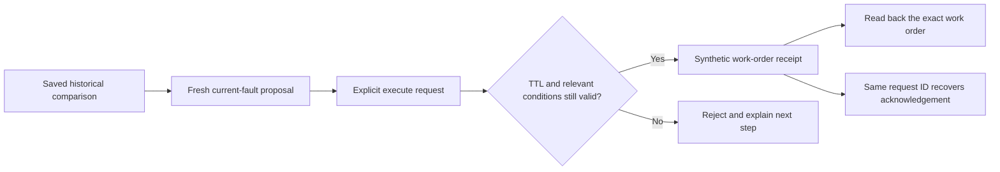

# Independent API review: bounded maintenance workflow

**Ten black-box check groups passed; zero application-contract failures were found.**
The workflow creates a synthetic work order, verifies its recorded identity, and
recovers the original acknowledgement after retries or a process restart. It
correctly leaves the closed or faulted asset unchanged. This is useful command and
audit discipline; it is not evidence that a technician repaired an asset or that
a forecast improved maintenance outcomes.

The actual HTTP run was **2026-10-19 20:14:15–20:15:04 UTC** on a dedicated gateway
at port 18150, with separate park, replay, planning-evidence and workflow databases.
The eight-hour fixed-release experiment on 18120 and the UI server on 18130 were
not modified. The test's gateway was stopped afterward.

## Evidence and source scope

[`operators/workflow_checks.py`](../../operators/workflow_checks.py) imports no
backend modules, reads no database, does not inject server exceptions, and does not
alter the clock. It drives only HTTP requests plus its own gateway process lifecycle.
Its saved evidence includes accepted receipts, current readbacks, rejection codes,
process identities and source-file hashes.

This was a candidate working-tree test, **not an acceptance run of a clean committed
release**. Startup health reported `dirty_git` above base commit
`a13b656fadfa0e976397d1900c1b1859be6e5836`. The entrypoint, workflow and planning files
had identical recorded hashes before and after the process restart. The exact
[evidence report](workflow-api-review/report.json) and
[source manifest](workflow-api-review/source-manifest.json) preserve that scope.
A later committed deployment needs its own revision-bound acceptance evidence.

## What passed

| Check group | Observed result |
|---|---|
| Saved comparison → proposal → execute → readback | One synthetic work order; exact receipt/readback ID; coaster remained closed; no physical completion claim |
| Concurrent duplicate requests | Four create retries retained proposal ID/expiry; four simultaneous execute calls produced one new audit event and one work order |
| Ordinary telemetry progression | Whole-state revision advanced; unchanged relevant preconditions still allowed execution |
| Changed scenario or intervening work order | Execution rejected; attempting another proposal for an already covered asset also rejected |
| Source quality and contradiction | Changed status, stale CMMS fields, contradictory open-order count and closure without a maintenance diagnosis rejected |
| Unsupported or hypothetical work | Non-active saved scenario, rerouting action and future scheduled dispatch rejected |
| Recorded view | Create/retry and execute POSTs rejected; historical proposal GET remained available; live execution resumed normally |
| Lost responses and restart | Client discarded both create and execute responses; GET proved each operation committed; stable IDs recovered original receipt after a real process restart |
| Expiry and historical acknowledgement | Unexecuted proposal rejected after **30.0118 actual seconds**; create retry did not renew expiry; a new create ID produced a fresh proposal; an older accepted command still recovered after expiry/reset |
| All advertised targets and cleanup | Coaster, wheel, power hub and water plant each produced matching work-order readback and remained faulted; fixture restored and owned gateway stopped |

Several items share one recorded check group; the report contains ten groups
including cleanup. The grouped checks also cover different-payload create conflicts,
different execute IDs and reuse of one execute ID across two proposals.

The lost-response test sends a complete HTTP request through a socket and consumes
zero response bytes. It then requires GET to show the committed proposal/result
before retrying. The restart is an actual stop/start with the same four database
files. **It does not inject a process crash between the park and workflow database
commits**; that narrower crash window remains covered by implementation-level tests,
not by this independent HTTP experiment.



## Value and usability findings

### P2: an intervening work order produces a misleading next step

When another dispatch creates a work order after proposal creation, execution
returns `proposal_preconditions_changed` and says to create a new proposal. Following
that instruction returns `work_order_already_open`, without an existing work-order
ID or navigation link. The rejection is safe, but the operator reaches a dead end.
The existing asset-detail API can retrieve the order; the error does not direct the
operator there.

Return the current open work-order IDs and an asset-detail link, with a differentiated
next step such as **open the existing work order**. For other changes, return the
relevant changed predicate fields so the operator understands why a new approval is
needed. Do not automatically rebase or extend the proposal. The coordinator has
implemented this response-context improvement with an additional regression test;
it was not part of the independent HTTP acceptance reported above.

### A saved comparison is useful evidence, but may be unnecessary friction

The successful dispatch required a current fault or inspection issue independently
of the saved forecast. For an obvious inspection alert, requiring simulation and
saving a comparison before creating a work order adds steps without demonstrated
predictive benefit. Consider an optional direct current-alert proposal using the
same freshness, deduplication and execution gates. Retain a comparison when it
actually informs the decision or provides useful audit rationale.

### Separate historical acceptance from current work-order status

After reset, the immutable acknowledgement still said `work_order_open`, while a
reconciled current readback correctly said `closed_by_reset`. The API preserves the
distinction. The UI should display both timestamps and label them clearly; presenting
one as the other would make an otherwise sound recovery contract confusing.

### Plan a retention/archiving workflow before a pilot

Proposal storage is intentionally capped and does not evict records automatically.
Expired records therefore consume capacity. A real operator needs a reviewed export,
archive and capacity-management procedure before this service becomes a daily tool.
This review did not fill the store or measure storage growth; the concern follows
the published retention contract rather than an observed full-store failure.

## Reproduce

The runner creates and stops its own gateway, uses a new output directory and four
independent database files, and refuses an already occupied port. It exercises only
synthetic data and leaves real external systems untouched.

```sh
python3 operators/workflow_checks.py \
  --project "$PWD" --python "$PWD/.venv/bin/python" \
  --port 18150 --output runtime/workflow-api-review/new-run
```

This does not test real CMMS authorization, employee identity, vendor idempotency,
physical work completion, distributed multi-gateway execution or rendering. Those
require separate integration evidence and operational ownership.

## Targeted retake: both response-context fixes verified

On **2026-10-19 20:24:31–20:24:40 UTC**, a new isolated gateway and four fresh
databases passed two focused HTTP checks plus cleanup. The earlier ten-group report
above is preserved unchanged; this retake verifies only the revised conflict and
readback contracts.

**The existing-work-order dead end is resolved.** Both an execution conflict and a
new proposal blocked by existing work now supplied the current order ID, the asset
API URL and `next_step: inspect_existing_work_order`. The execution response also
identified the changed predicates: observed open-order count changed from zero to
one, and the open-order ID list changed from empty to that exact order. Following
the provided URL with a read-only GET returned the identified open work order.

**Recovering a receipt no longer implies fresh asset telemetry.** After accepting a
maintenance command, the test paused ride SCADA and waited **6.2058 real seconds**,
exceeding the source's five-second threshold plus one second. Canonical state
reported the original status observation as stale. Retrying the same accepted
execution ID preserved the original receipt and created no new audit event. Its
work-order readback was current at `20:24:40.330 UTC`, while separate
`asset_status_evidence` retained the original SCADA timestamp
`20:24:34.008 UTC`, source `ride_scada`, value `closed` and quality `stale`.
The readback explicitly limited the database timestamp's scope to the work order.

The gateway was stopped after restoring the fixture. Neither the fixed eight-hour
experiment nor the UI gateway was changed. This remains a candidate working-tree
HTTP retake with exact source hashes, not a newly deployed GPU acceptance.

[Targeted report](workflow-api-review/p2-retake/report.json)
· [Source manifest](workflow-api-review/p2-retake/source-manifest.json)
· [Actual stale-source recovery response](workflow-api-review/p2-retake/stale-recovery-response.json)
· [Retake client](../../operators/workflow_retest.py)

```sh
python3 operators/workflow_retest.py \
  --project "$PWD" --python "$PWD/.venv/bin/python" \
  --port 18150 --output runtime/workflow-api-review/new-focused-run
```
