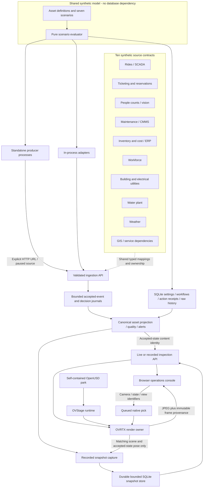

# Implemented data flow and ownership

This diagram describes the implemented revision 2 application. [Validation](validation.md)
links exact deployed-source, native GPU/browser and HTTP/restart evidence. Planned
vendor protocols are listed separately in the connector catalog.

The twin provides spatial context across ERP, CMMS and operating feeds. It does
not become an ERP or a ride control system. Accepted source values have explicit
ownership; informational observations can differ without overwriting the owner.
Fields without a mapping remain labeled synthetic model values.

| Boundary | Owner | What it preserves |
|---|---|---|
| Asset and scenario definitions | `backend/domain.py` | Stable IDs and synthetic model inputs |
| Scenario rules | `backend/model_rules.py` | Pure evaluation; explicit time and workflow inputs |
| Persistence and actions | `backend/simulator.py` | SQLite settings, telemetry, audits and work orders |
| Source mappings | `backend/connectors/catalog.py` | IDs, units, ranges, canonical ownership and planned protocols |
| Event acceptance | Connector runtime and store | Validation, deduplication, late decisions, cursor lifetime |
| Operator asset state | `ParkReadModel` | Accepted values, provenance, quality and content identity |
| Recorded inspection | Replay store and API | Immutable full-state records; shared read-only view |
| Native GPU resources | Renderer loop | Sole SDK owner, queued commands, teardown and frame publication |
| Source delivery | Standalone producers | Explicit synthetic batches and bounded transport retries |
| Source release | Release artifact and startup identity | Exact committed bytes, staging and startup disk inspection |

The simulator's raw history and scenario comparison remain model outputs. They
are not reconstructed histories or predictions of externally injected observations.
The browser labels this distinction. The accepted event stream is memory bounded
and resets on restart; the recorded full-state snapshots persist separately.

A JPEG's frame number, render time, accepted-state revision, camera and projected
asset coordinates travel together. The UI suppresses annotations when association
is unavailable. Matching data alone does not prove historical geometry: a record
without a captured matching pose explicitly says so. One camera/view is shared
across clients, and the project is still a prototype behind authenticated access.

[Standalone source examples](synthetic-producers.md) · [Connector contract](connectors.md)
· [Recorded views](replay.md) · [Independent reviews](reviews/README.md)
