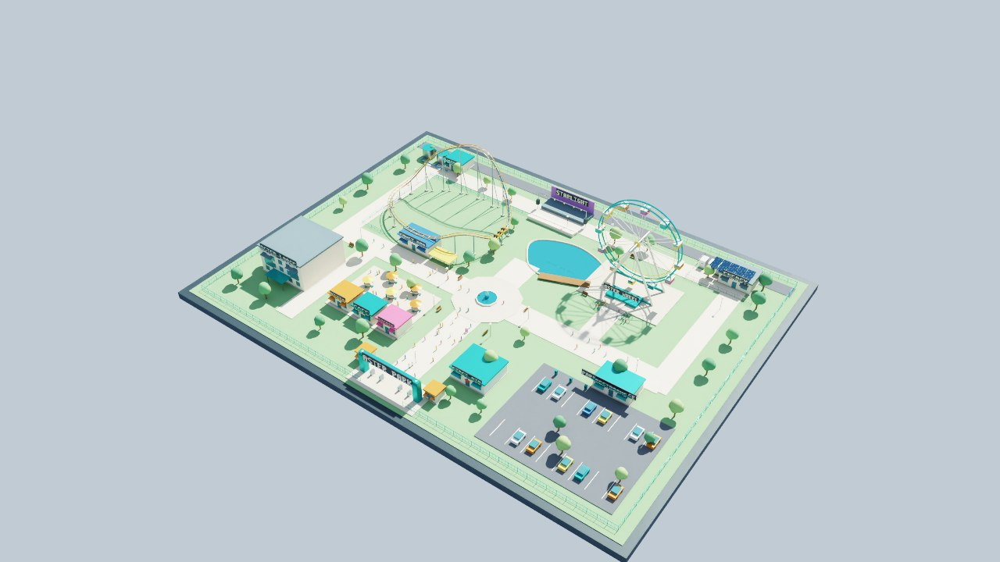
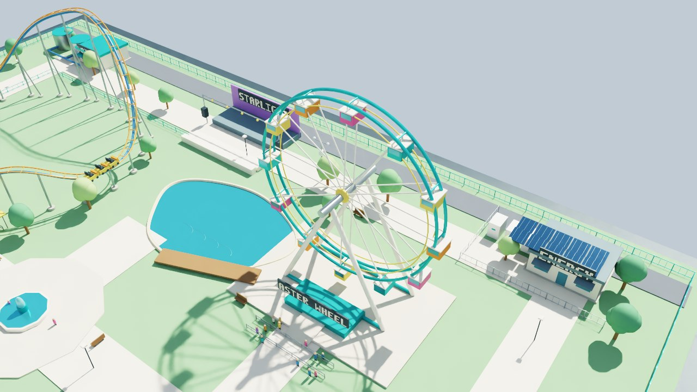
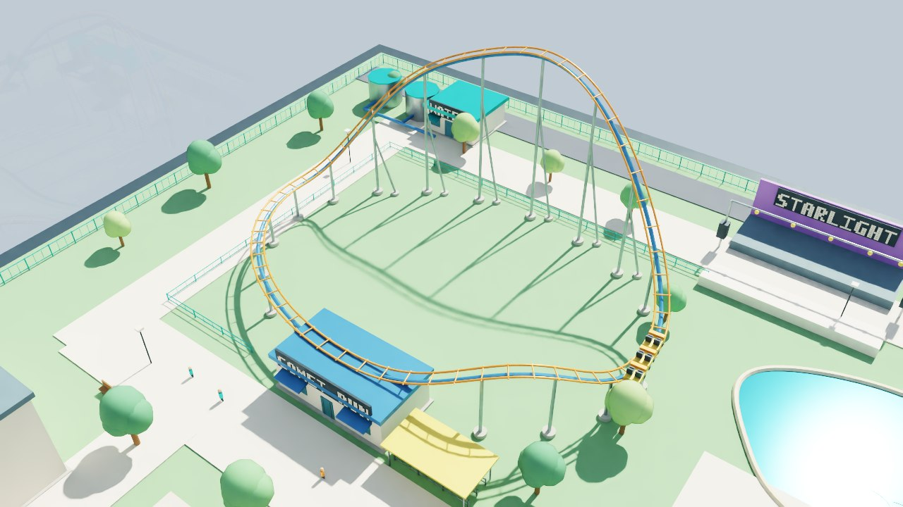
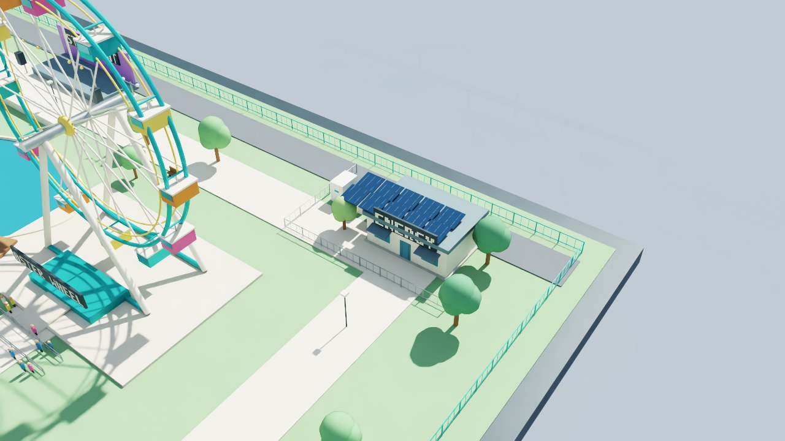
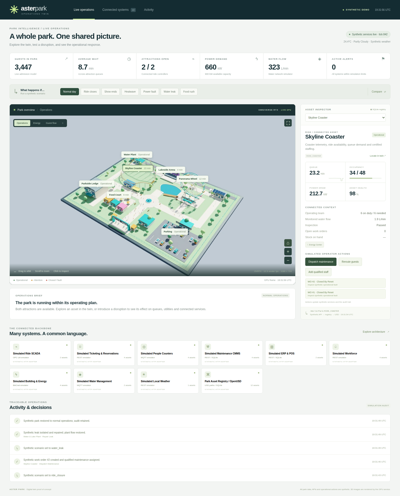
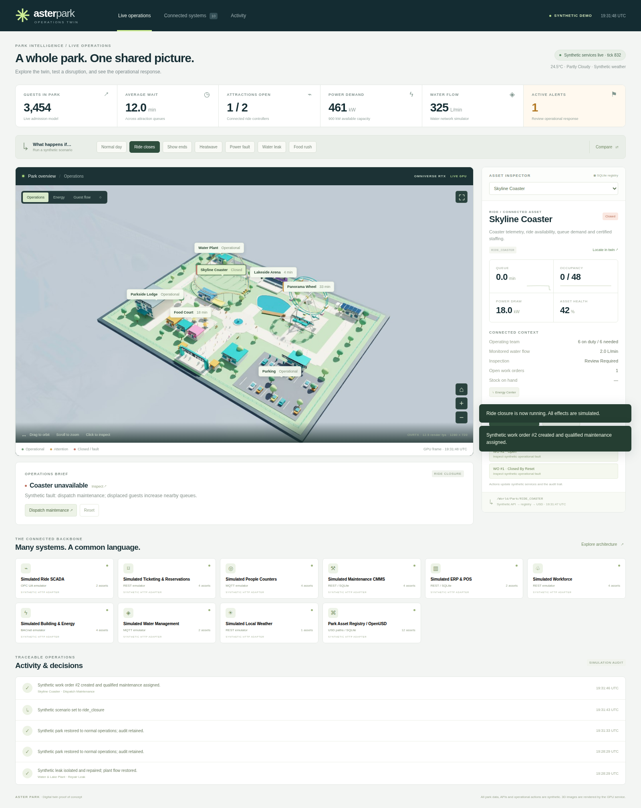
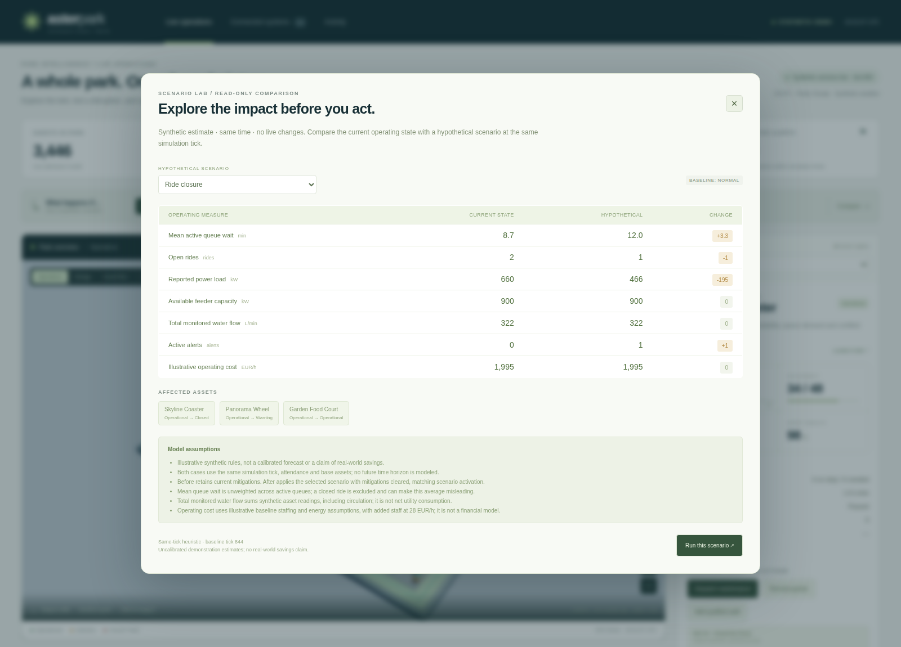

# Project progress and review gallery

**Snapshot: 15 October 2026. Working GPU proof of concept.**

This page is the review entry point. It tracks the [original project request](project-prompt.md),
links editable deliverables, and shows actual renders from the running application.
The concept deck is a design proposal; the captures below are implementation evidence.

## Delivery checklist

| Requested outcome | Status | Review evidence |
|---|---|---|
| Explore the API ecosystem and operational value | Complete for concept stage | [Integration roadmap](integration-roadmap.md), [research sources](deck-source/sources.md) |
| Illustrated project slide deck | Complete | [Ten-page PDF](project-concept.pdf), [editable deck source](deck-source/) |
| Provision a Horde GPU and use actual OVStage/OVRTX | Implemented and run on L40 | [Validation record](validation.md), SDK versions in [capture manifest](images/render-captures.json) |
| Park with fence, trees, water and rides | Complete for POC | [OpenUSD scene](../assets/park.usdc), [editable Blender model](../assets/park.blend), renders below |
| Synthetic Python systems and database | Implemented | [Backend contract](backend.md), 12 assets, 10 source feeds, 19 passing tests |
| Click geometry to identify an asset | Verified | Three distinct native picks in [browser results](images/browser-validation.json) |
| Interactive operations application | Verified | Camera controls, live telemetry, asset inspection, scenario comparison and audited actions |
| Ride state affects animation | Verified | Closed coaster pauses; wheel continues; reset resumes coaster |
| Public source, assets, prompts and progress | Included in this repository | [Prompt](project-prompt.md), [asset index](../assets/README.md), [README](../README.md) |

## Actual RTX renders

Four views of the current implemented model, captured through the running OVRTX
service. These are different viewpoints of the same milestone, not invented
historical stages. [Capture metadata](images/render-captures.json) records UTC time,
renderer versions, camera and frame number.

### Whole park

### Ferris wheel and lake

### Coaster and queue area

### Utility infrastructure

## Application progress

### Live operations and connected asset data

### Ride closure and response workflow

### Compare a scenario before applying it

More captures: [connected architecture](images/connected-architecture.png),
[mobile view](images/mobile-live.png), [clean viewport](images/ovrtx-viewport.png).

## What remains beyond this POC

- [ ] Select a real park pilot, decision owner and baseline success measurements.
- [ ] Connect authorized read-only data from one ride/queue source and one utility system.
- [ ] Replace synthetic IDs with governed asset mappings; validate timestamps, units and quality.
- [ ] Add real acknowledgements and permissions before any external operational writeback.
- [ ] Calibrate queue/crowd/resource models and evaluate forecasts against held-out days.
- [ ] Add replay and separate scenario branches using recorded observations.
- [ ] Add per-user camera/session isolation and production streaming, authentication and monitoring.
- [ ] Improve geometry, terrain and multi-car coaster motion using measured engineering inputs.
- [ ] Add an optional AI assistant only once source provenance and action permissions are defined.

The prototype currently uses synthetic HTTP feeds, heuristic scenarios and one
shared GPU session. It does not yet connect commercial ERP/SCADA, control physical
rides, predict real crowd behavior, or demonstrate financial savings. See the
[validation limits](validation.md#limits-of-the-evidence).

## How to control the next iteration

1. Review the PDF and the four model renders for scope and appearance.
2. Follow the [five-minute walkthrough](demo-walkthrough.md) in the running demo.
3. Compare behavior with the checklist above and record desired changes as GitHub
   issues, referencing an asset ID, scenario and screenshot where possible.
4. Choose one pilot direction: operations response, utilities/maintenance, or
   planning/guest experience. The [roadmap](integration-roadmap.md) gives measurable
   starting criteria for each.

For future snapshots, rerun `scripts/capture_progress.py` against the running GPU
service, update this page's date/checklist, and commit the captures with the code
change. Git history preserves earlier versions of the gallery.
