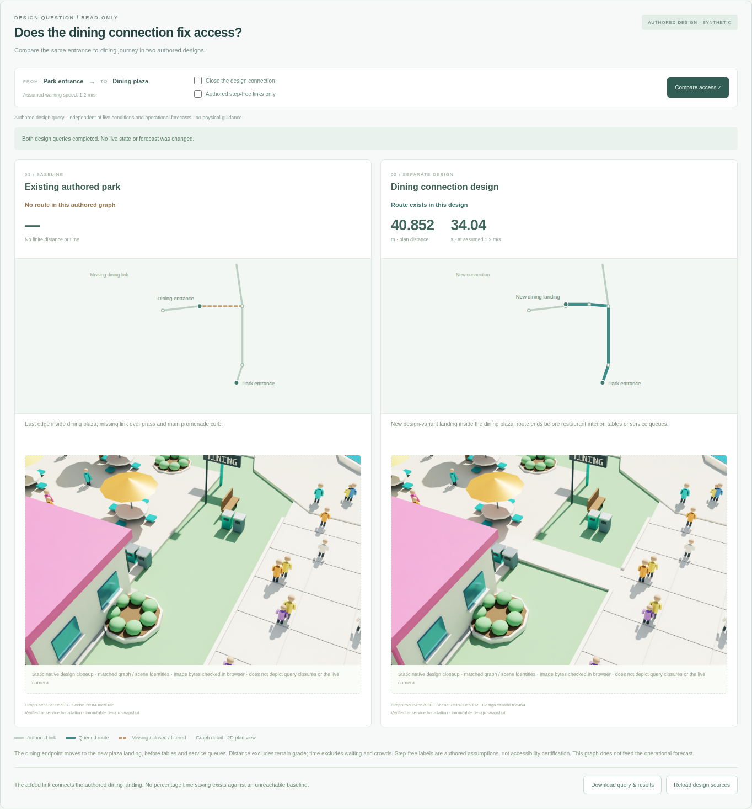
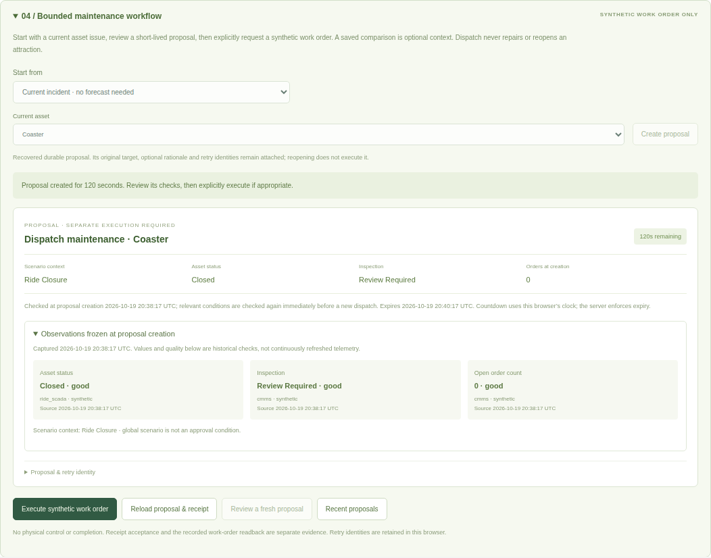
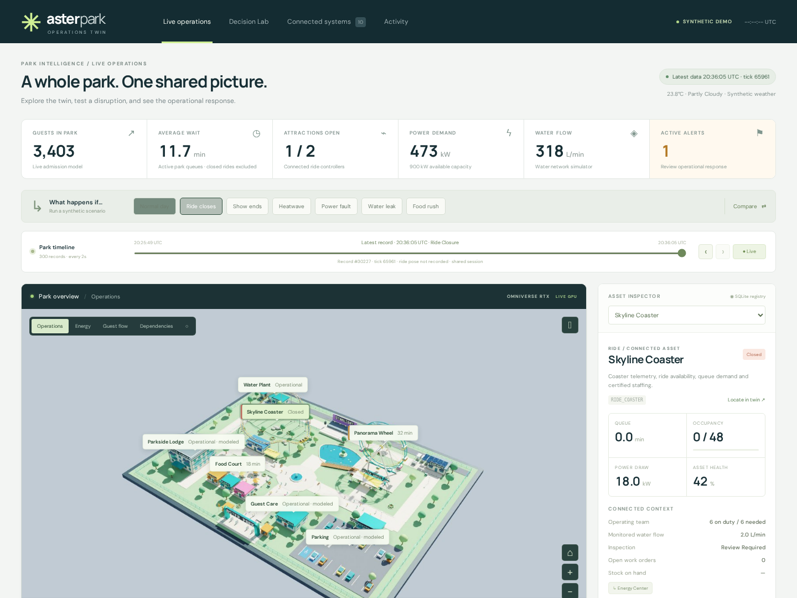
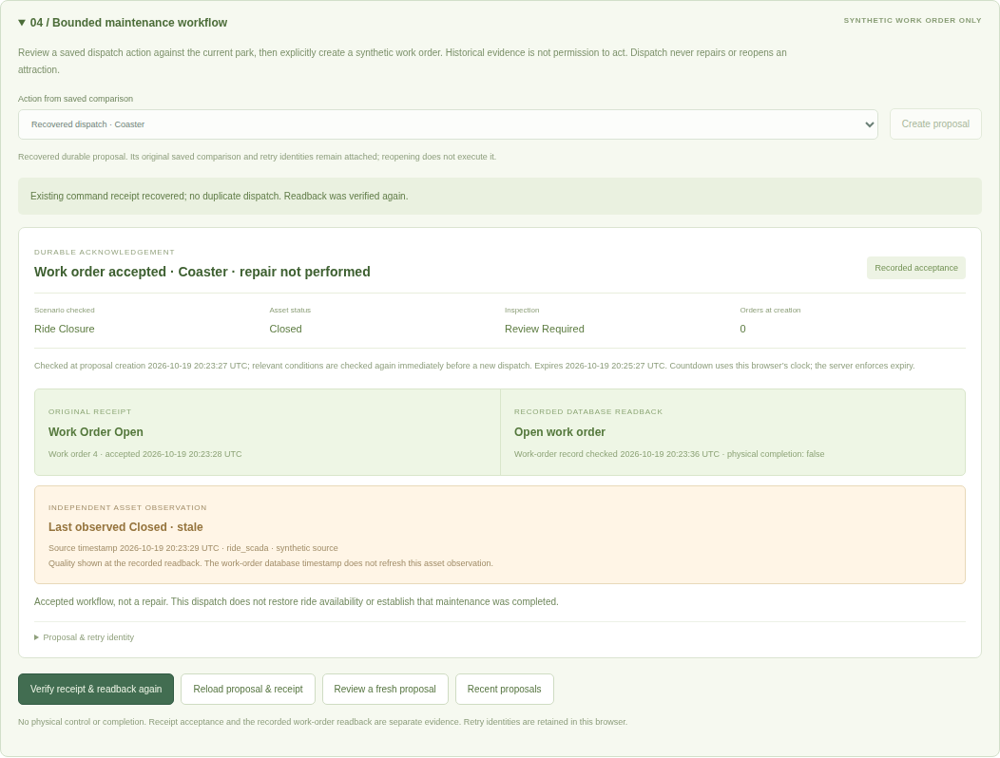
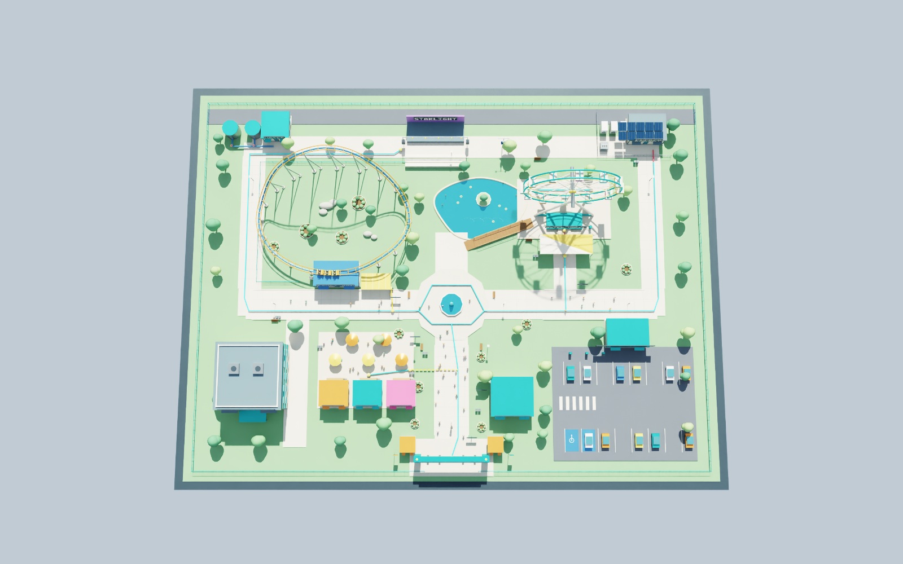
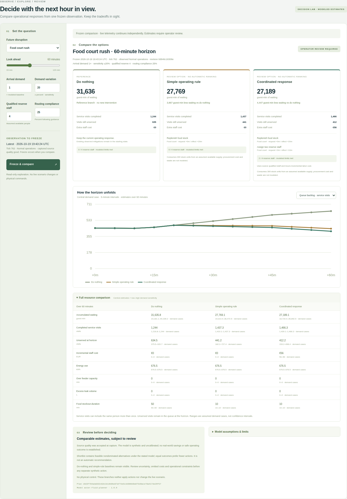
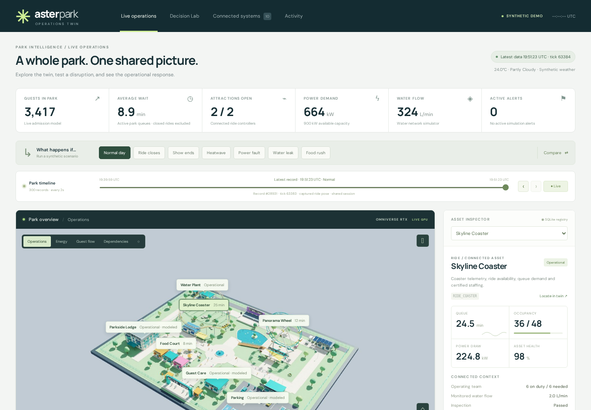

# Project progress and review gallery

**Four-hour observation checkpoint, 19 October 23:48 UTC:** 49 complete API
cycles / 491 checks / zero failures; 482 GPU samples / one retained failure.
Both runs continue. [Reconciled current evidence](experiments/run-analysis/checkpoint-4h/analysis.md),
[independent review](experiments/run-analysis/checkpoint-4h/review.md) and the
[scheduled native frame](images/fox-cycle-20261019/observation-4h/frame.jpg)
are available for review. The application has remained unchanged since 20:52 UTC.
The [two-hour checkpoint](experiments/run-analysis/checkpoint-2h/review.md) remains available.

**19 October, evidence and presentation checkpoint.**
[Watch the 88-second actual GPU application update](video/fox-update/README.md) ·
[Five-page implementation review (PDF, interim)](fox-review-interim.pdf).
The video passed full decoding and sampled inspection of all ten chapters. The
deck keeps synthetic execution, static design evidence and unfavorable policy
results explicit. Eight-hour testing continues; neither artifact claims completion.

The [independent tooling review](reviews/2026-10-19-evidence-tooling-review.md)
identified and verified fixes to the final reporting gate. Sixteen focused checks
now cover sparse observations, timing contradictions, pauses and source identity.
A [reconciled partial checkpoint](experiments/run-analysis/coverage-v2-idle-checkpoint/analysis.md)
contains 19 API cycles / 191 checks / zero failures, alongside the explicitly
historical 145-sample GPU prefix. No application changes were needed.

**19 October, fourth checkpoint — a complete design comparison.**
The Decision Lab now asks whether the dining connection fixes access. It compares
matched baseline/design graphs and actual native RTX closeups, with a connector
closure and authored step-free filter as negative controls. Queries preserve
live and recorded park state. The native previews are static: a query closure
does not alter their geometry or the live camera.

[Actual local browser/API report](images/fox-cycle-20261019/spatial-ui/report.json) ·
[Native render provenance and reproduction](circulation-native-rendering.md) ·
[Exported route comparison](images/fox-cycle-20261019/spatial-ui/before-after-query.json)

The repository suite passes **407 tests**, with three browser modules skipped in
that environment. The dedicated browser environment passes 40 checks; the actual
local spatial walkthrough passes seven checks, including PNG byte hashes, route
closure, the unresolved entrance threshold, JSON export and mobile layout. These
are local application checks using separately captured L40 native images; new
immutable GPU application deployment acceptance is now recorded separately: the
`afa84a1` L40 release passed [six direct-incident checks](images/fox-cycle-20261019/gpu-incident-afa84a1/report.json)
and [seven spatial checks](images/fox-cycle-20261019/gpu-spatial-afa84a1/report.json).
The reports contain verified release identities; design previews retain their
separate static capture provenance.

The dining proposal provides a route in this partial authored graph. It does not
prove increased throughput, physical guidance or accessibility. The original
scene remains unchanged, and the queue forecast still has no spatial origins or
travel model. [Research on coupling the models](research/spatial-planning-coupling.md)
explains the missing inputs and a staged pilot. Eight-hour observation continues.

**19 October, third checkpoint — direct incidents and queryable design alternatives.**
Operators can now prepare maintenance directly from an asset or maintenance alert,
review three frozen source observations, and explicitly create and execute a
synthetic work order. A saved forecast is optional context. The local browser
walkthrough used four scripted steps versus seven through a saved comparison;
this is a UI path comparison, not a measured human productivity improvement.

[Direct incident browser evidence](images/fox-cycle-20261019/current-incident/report.json) ·
[Read-only spatial API](spatial-api.md) ·
[Independent HTTP review: eleven groups passed](experiments/incident-spatial-api-review.md) ·
[Current run status](experiments/2026-10-19-run-status.md)

The current repository suite passes **354 tests** with two browser modules skipped
in that Python environment. The separate browser environment passes 28 workflow
checks; an actual isolated API/browser walkthrough passes six more. These local
changes are distinct from the twelve **actual GPU/browser checks of committed
release `64c8bfa`**, which cover response loss, reload recovery, source staleness,
replay and intervening work orders. Its [report](images/fox-cycle-20261019/gpu-workflow-64c8bfa/report.json)
records verified source identity and exact native frame provenance.

The eight-hour runs remain in progress. Spatial queries use immutable authored
graphs and return explicit unreachable results. They do not change live park
state, validate physical guidance, or feed the queue forecast.

**19 October, second checkpoint — bounded dispatch and spatial design review.**
The new [maintenance workflow](bounded-maintenance-workflow.md) passed an
[independent HTTP review](experiments/workflow-api-review.md): ten check groups,
including actual expiry, concurrent retries, lost responses and process restart.
The closed ride stays closed after dispatch. A subsequent usability fix identifies
an intervening work order instead of telling the operator to recreate a proposal;
20 implementation-level workflow tests cover the updated contract.

The [circulation audit](circulation.md) exposed disconnected paving, queue rails,
a utility fence and unresolved entry thresholds. A separate
[dining connection design](dining-design-variant.md) changes one unreachable plaza
entrance into a 40.852 m authored route, while preserving the original assets.
Thirty-two CPU checks cover the baseline graph and variant, with separate actual
USD inspection evidence. The repository suite passes 301 tests; two browser modules
are skipped in that environment, while the dedicated browser environment passes
21 tests and twelve actual local API/browser checks.

[Workflow browser report](images/fox-cycle-20261019/workflow-ui/report.json)

The eight-hour observation is still running. A separate actual L40/OVRTX capture
now shows the baseline route audit; it carries no live telemetry.

[Native capture report](images/fox-cycle-20261019/circulation-baseline/report.json).
The dining variant still needs its own GPU comparison evidence.

**19 October 2026 — FOX-inspired decision planning and an eight-hour evaluation cycle.**
The new Decision Lab compares frozen canonical observations over 15–120 minutes,
with do-nothing/simple-rule alternatives, action delays, finite reserve staffing,
conserved service demand, and explicit assumptions. All seven scenarios passed an
actual local API/browser check. These first screenshots show the working browser
and synthetic planner; they are **not new GPU-render evidence**.

[Research and decision/API map](research/fox-theme-park.md) ·
[Experiment charter](experiments/2026-10-19-run-plan.md) ·
[Independent policy stress results](experiments/food-service-policy-stress.md) ·
[Saved evidence contract](planning-evidence.md) ·
[External weather preview](external-weather-preview.md) ·
[Independent value review](reviews/2026-10-19-value-baseline.md) ·
[HTTP operator evaluation](api-operator-evaluation.md) ·
[Browser evidence](images/fox-cycle-20261019/initial/report.json)

The same initial release now passed **actual Horde browser/API/OVRTX checks** on
an L40: all seven planning scenarios, infeasible staffing, desktop/mobile layout,
and no browser page errors. Source and scene hashes are recorded in the
[GPU browser report](images/fox-cycle-20261019/gpu-initial/report.json).

[GPU Decision Lab screenshot](images/fox-cycle-20261019/gpu-initial/decision-lab-desktop.png) ·
[Exact downloaded RTX frame](images/fox-cycle-20261019/gpu-initial/render-overview.jpg)

The first implementation passed 214 CPU/API tests before subsequent review fixes.
An independent review caught an HVAC constraint that depended on the requested
scenario label rather than the observed temperature; that counterexample is now
covered. The numerical model is synthetic and uncalibrated. Forecast sensitivity
is an assumption sweep, not a confidence interval or demonstrated operating value.
The eight-hour runs will report actual start/end times and interruptions separately
from accelerated simulated horizons; no eight-hour result is claimed yet.

**15 October 2026 — revision 2 runs on the L40 GPU, with actual browser acceptance.**

**16 October 2026 — [captioned application video](video/README.md).** A 3½-minute
walkthrough records the running L40 deployment at `19cee1e`: all seven scenarios,
six operator-action families, API/source inspection, native selection and replay.
The video uses actual browser/GPU footage and synthetic operational data. Recording
and editing scripts, chapter captions and a capture manifest are included.

[Project prompt](project-prompt.md) · [10-page concept PDF](project-concept.pdf) ·
[Editable deck](deck-source/) · [OpenUSD / Blender assets](../assets/README.md) ·
[Validation evidence](validation.md) · [Independent reviews](reviews/)

## What is working

The park now joins 12 identified assets, ten synthetic source domains and 138 typed
source fields with a real OVStage/OVRTX scene. The browser supports native geometry
picking, live inspection, source-quality controls, logical dependencies, incident
workflows and read-only recorded views. ERP/CMMS/SCADA names identify synthetic
integration boundaries; no commercial system or physical ride is connected.

| Completed checkpoint | Evidence |
|---|---|
| Canonical source ingestion, units, ownership, event receipts and freshness | [Connector contract](connectors.md), [standalone producers](synthetic-producers.md) |
| Revision 2 landscape, queues, utility details and three independently posed coaster cars | [Scene validation](../assets/scene_quality_validation.json), [authoring contract](scene-authoring.md) |
| Editable revision 2 Blender handoff saved and reopened | 2,997 objects, 2,954 meshes, 33 materials; [verified report](../assets/blender_validation.json) |
| Exact-image annotations and stable asset selections (`2e2b16b`) | [Actual browser checks](images/revision2/final/browser-validation.json), [extended checks](images/revision2/final/extended/extended-browser-validation.json) |
| Source ingestion continues during historical inspection (`2c763d2`) | All ten independent producers tested across replay; selected asset values and KPIs remain unchanged |
| Durable action request IDs (`19cee1e`) | [Action acknowledgement contract](action-contract.md): retry, conflict, concurrent requests, restart and rollback checks |
| Immutable committed releases and startup source identity | [Deployment contract](deployment.md), exact commit/scene identities in capture reports |
| Recurring independent review | Keep the project; targeted refactoring has more value than starting again. [Review history and triggers](reviews/) |

At `19cee1e`, **184 CPU/API tests pass**. The UI also passes **28 JavaScript behavior
checks and 58 DOM references**. Actual browser/GPU evidence below is explicitly
bound to `2e2b16b`. The final `19cee1e` deployment separately passed [browser smoke](images/revision2/release19/browser/browser-validation.json),
[native startup/cleanup](images/revision2/release19/native-lifecycle-validation.json),
[actual HTTP acquisition/action retries](images/revision2/release19/workflow-initial.json)
and [backend-restart receipt recovery](images/revision2/release19/workflow-restart.json).

## Revision 2 — actual OVRTX gallery

These are GPU renders of the implemented model, not concept illustrations.
[Capture manifest](images/revision2/final/gallery/render-captures.json) records the
release, scene SHA, image SHA and the exact JPEG's camera/source/frame headers.

### Whole park

### Coaster and shaded queue

### Ferris wheel and lake

### Utility infrastructure

## Operator experience

The inspector shows latest observations. Scene annotations use the immutable source
revision attached to the displayed GPU image, with a separate capture-time caption.
In a 100-sample live check, annotations were visible in **92% of samples**, up from
63% before the fix, with **zero image/annotation revision mismatches**. Brief gaps
remain while a new exact revision is fetched; this is a session observation, not a
production performance guarantee.

Native picks resolved food court, hotel and power-hub geometry to the correct
records. Each target required one retry after the displayed context changed; the
rejected 409 responses remain in the evidence. Closure stopped the coaster while
the wheel continued; reset resumed it. Dispatch, simulated leak repair, scenario
comparison and camera controls passed. No browser page errors or desktop/mobile
horizontal overflow were observed.

[Ride closure](images/revision2/final/operations-ride-closure.png) ·
[Scenario comparison](images/revision2/final/scenario-comparison.png) ·
[Source staleness](images/revision2/final/extended/source-stale.png) ·
[Dependency overlay](images/revision2/final/extended/logical-dependencies.png) ·
[Recorded inspection](images/revision2/final/extended/recorded-view.png) ·
[Mobile](images/revision2/final/mobile-live.png)

## Review conclusions and next decisions

The independent reviews recommend preserving the tested identity, source-state,
replay and renderer boundaries. Extract focused modules when changing a feature
that crosses those boundaries; a complete rewrite has no demonstrated payoff.
Reviews recur at meaningful integrated milestones, approximately every 60–90
minutes during active development, and after changes to state ownership or API
contracts. [Review protocol](reviews/README.md).

The next product choices are a real pilot owner, authorized source connections,
calibrated decision models and measured operating outcomes. Saved comparison
branches, per-user sessions, production streaming, access control and external
command acknowledgements remain separate work. Current scenario comparison is a
same-tick heuristic; ride motion is presentation animation; all operational values
and actions are synthetic.

Use the [walkthrough](demo-walkthrough.md) to assess the application, then record
changes as GitHub issues with an asset ID, scenario and screenshot. The [integration
roadmap](integration-roadmap.md) describes operations, utilities and planning pilots.

## Earlier evidence

The [original revision 1 overview](images/render-overview.jpg),
[revision 1 browser results](images/browser-validation.json), and
[first revision 2 cadence measurement](images/revision2/annotation-cadence.json)
are retained as historical checkpoints. Earlier network restrictions and pending
GPU statements in dated development-log/review entries describe those earlier
states; they are not the current deployment status.

### Independent ledger checkpoint, 21:03 UTC

The [offline report](experiments/run-analysis/interim-2105/analysis.md) reconciles
16 API cycles / 161 checks / zero failures and a separately captured GPU prefix
of 145 samples / one failure. Both runs remain incomplete. The report keeps source
changes, sampling limits and resource coverage explicit; its final-summary gate
cannot label a partial prefix as an eight-hour result.
