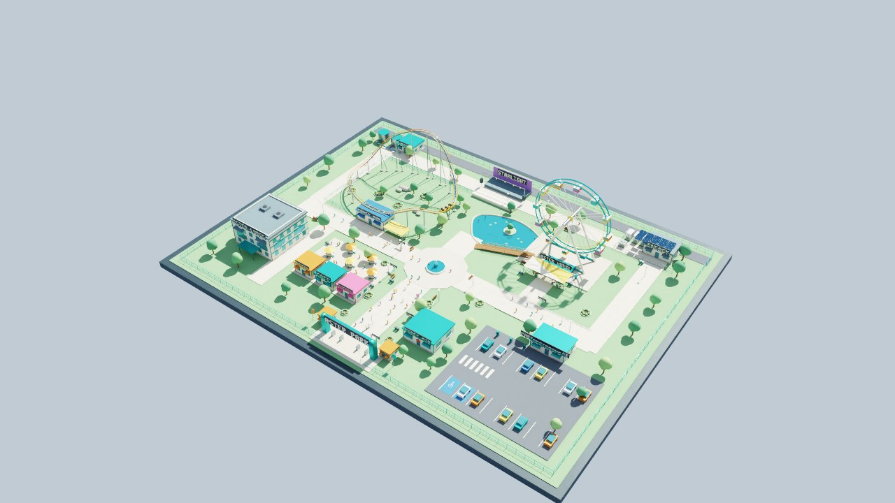
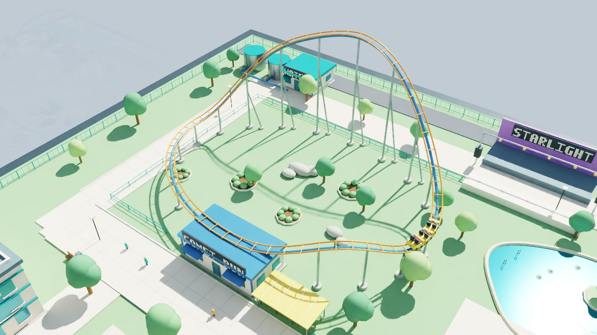
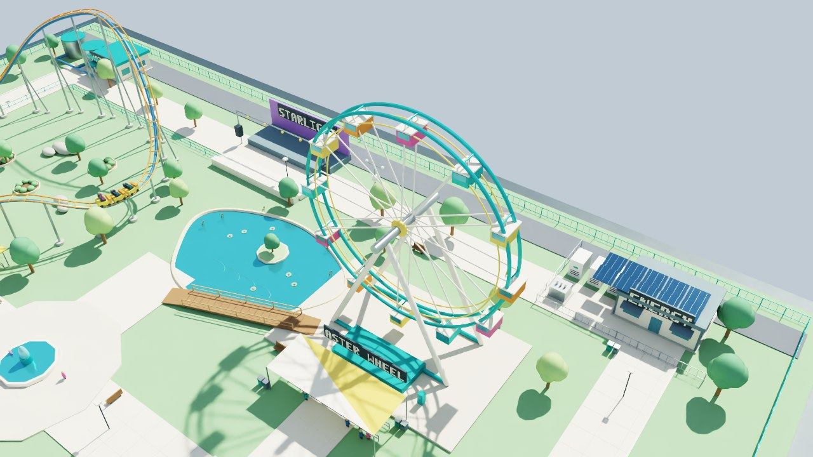
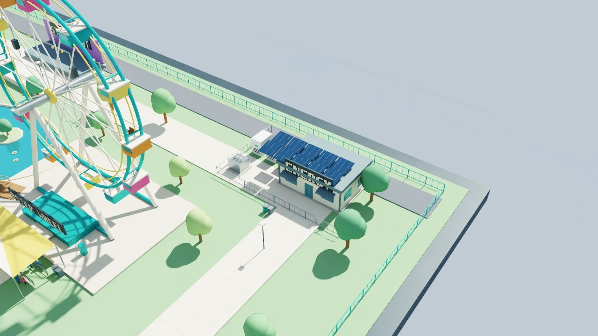
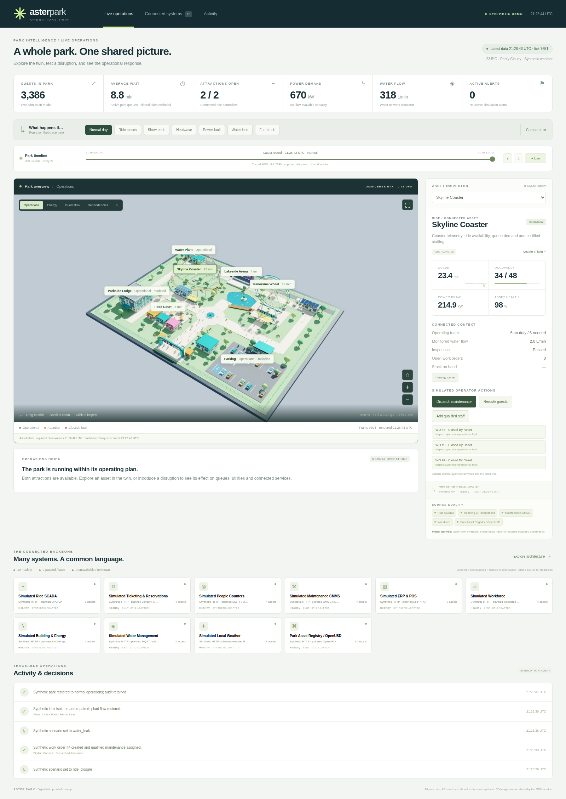

# Project progress and review gallery

**15 October 2026 — revision 2 runs on the L40 GPU, with actual browser acceptance.**

**16 October 2026 — [captioned application video](video/README.md).** A 3½-minute
walkthrough records the running L40 deployment at `19cee1e`: all seven scenarios,
six operator-action families, API/source inspection, native selection and replay.
The video uses actual browser/GPU footage and synthetic operational data. Recording
and editing scripts, chapter captions and a capture manifest are included.

[Project prompt](project-prompt.md) · [10-page concept PDF](project-concept.pdf) ·
[Editable deck](deck-source/) · [OpenUSD / Blender assets](../assets/README.md) ·
[Validation evidence](validation.md) · [Independent reviews](reviews/)

## What is working

The park now joins 12 identified assets, ten synthetic source domains and 138 typed
source fields with a real OVStage/OVRTX scene. The browser supports native geometry
picking, live inspection, source-quality controls, logical dependencies, incident
workflows and read-only recorded views. ERP/CMMS/SCADA names identify synthetic
integration boundaries; no commercial system or physical ride is connected.

| Completed checkpoint | Evidence |
|---|---|
| Canonical source ingestion, units, ownership, event receipts and freshness | [Connector contract](connectors.md), [standalone producers](synthetic-producers.md) |
| Revision 2 landscape, queues, utility details and three independently posed coaster cars | [Scene validation](../assets/scene_quality_validation.json), [authoring contract](scene-authoring.md) |
| Editable revision 2 Blender handoff saved and reopened | 2,997 objects, 2,954 meshes, 33 materials; [verified report](../assets/blender_validation.json) |
| Exact-image annotations and stable asset selections (`2e2b16b`) | [Actual browser checks](images/revision2/final/browser-validation.json), [extended checks](images/revision2/final/extended/extended-browser-validation.json) |
| Source ingestion continues during historical inspection (`2c763d2`) | All ten independent producers tested across replay; selected asset values and KPIs remain unchanged |
| Durable action request IDs (`19cee1e`) | [Action acknowledgement contract](action-contract.md): retry, conflict, concurrent requests, restart and rollback checks |
| Immutable committed releases and startup source identity | [Deployment contract](deployment.md), exact commit/scene identities in capture reports |
| Recurring independent review | Keep the project; targeted refactoring has more value than starting again. [Review history and triggers](reviews/) |

At `19cee1e`, **184 CPU/API tests pass**. The UI also passes **28 JavaScript behavior
checks and 58 DOM references**. Actual browser/GPU evidence below is explicitly
bound to `2e2b16b`. The final `19cee1e` deployment separately passed [browser smoke](images/revision2/release19/browser/browser-validation.json),
[native startup/cleanup](images/revision2/release19/native-lifecycle-validation.json),
[actual HTTP acquisition/action retries](images/revision2/release19/workflow-initial.json)
and [backend-restart receipt recovery](images/revision2/release19/workflow-restart.json).

## Revision 2 — actual OVRTX gallery

These are GPU renders of the implemented model, not concept illustrations.
[Capture manifest](images/revision2/final/gallery/render-captures.json) records the
release, scene SHA, image SHA and the exact JPEG's camera/source/frame headers.

### Whole park

### Coaster and shaded queue

### Ferris wheel and lake

### Utility infrastructure

## Operator experience

The inspector shows latest observations. Scene annotations use the immutable source
revision attached to the displayed GPU image, with a separate capture-time caption.
In a 100-sample live check, annotations were visible in **92% of samples**, up from
63% before the fix, with **zero image/annotation revision mismatches**. Brief gaps
remain while a new exact revision is fetched; this is a session observation, not a
production performance guarantee.

Native picks resolved food court, hotel and power-hub geometry to the correct
records. Each target required one retry after the displayed context changed; the
rejected 409 responses remain in the evidence. Closure stopped the coaster while
the wheel continued; reset resumed it. Dispatch, simulated leak repair, scenario
comparison and camera controls passed. No browser page errors or desktop/mobile
horizontal overflow were observed.

[Ride closure](images/revision2/final/operations-ride-closure.png) ·
[Scenario comparison](images/revision2/final/scenario-comparison.png) ·
[Source staleness](images/revision2/final/extended/source-stale.png) ·
[Dependency overlay](images/revision2/final/extended/logical-dependencies.png) ·
[Recorded inspection](images/revision2/final/extended/recorded-view.png) ·
[Mobile](images/revision2/final/mobile-live.png)

## Review conclusions and next decisions

The independent reviews recommend preserving the tested identity, source-state,
replay and renderer boundaries. Extract focused modules when changing a feature
that crosses those boundaries; a complete rewrite has no demonstrated payoff.
Reviews recur at meaningful integrated milestones, approximately every 60–90
minutes during active development, and after changes to state ownership or API
contracts. [Review protocol](reviews/README.md).

The next product choices are a real pilot owner, authorized source connections,
calibrated decision models and measured operating outcomes. Saved comparison
branches, per-user sessions, production streaming, access control and external
command acknowledgements remain separate work. Current scenario comparison is a
same-tick heuristic; ride motion is presentation animation; all operational values
and actions are synthetic.

Use the [walkthrough](demo-walkthrough.md) to assess the application, then record
changes as GitHub issues with an asset ID, scenario and screenshot. The [integration
roadmap](integration-roadmap.md) describes operations, utilities and planning pilots.

## Earlier evidence

The [original revision 1 overview](images/render-overview.jpg),
[revision 1 browser results](images/browser-validation.json), and
[first revision 2 cadence measurement](images/revision2/annotation-cadence.json)
are retained as historical checkpoints. Earlier network restrictions and pending
GPU statements in dated development-log/review entries describe those earlier
states; they are not the current deployment status.
