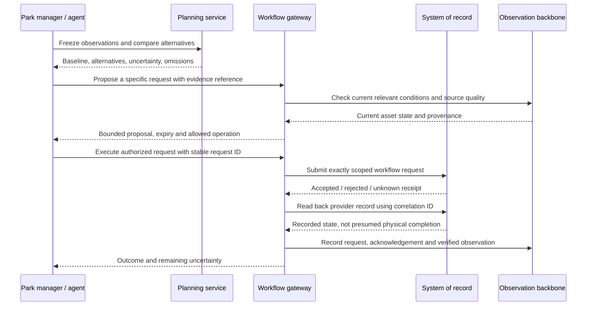

# From a FOX-inspired decision to an operational request

The useful park analogue of a factory manager is an operations coordinator that
can explain a disruption, compare responses and submit a bounded request to the
system that owns the work. It is not a replacement for ERP, a ride controller, or
the duty manager. This design extends the [FOX research](fox-theme-park.md).

## Connection map and action boundaries

| System of record | Observations the twin needs | Useful request | Evidence of execution |
| --- | --- | --- | --- |
| Ride OEM / SCADA | Operating state, alarms, throughput, inspection and availability | Inspection or maintenance request | Work-order receipt and later authorized inspection/operating-state update |
| Ticketing / reservations | Booked arrival windows, scans, admission limits, entitlement | Propose a time-window/capacity change | Vendor record version and affected bookings; contractual constraints retained |
| Queue counters / video analytics | Zone counts, directions, coverage, confidence | Observation/recount task | New timestamped count and confidence; no inferred identity required |
| Workforce / dispatch | On-duty roster, skills, shift/break constraints, reserve, travel time | Request a qualified reserve assignment | Supervisor acknowledgement, accepted assignment and arrival; donor coverage remains valid |
| ERP / POS / kitchen | Orders, transaction rate, inventory, available upstream stock | Reserve stock and request replenishment | Separate reservation, shipment and receipt records; an order is not delivered stock |
| CMMS / field service | Assets, work orders, skills, spares, permits, estimated restoration | Create an inspection work order | Provider ID/status plus readback; no automatic repair or reopening claim |
| BMS / energy | Meter hierarchy, feeder limits, HVAC state, room temperatures | Approved noncritical setpoint envelope | Acknowledged profile, meter response, expiry/rollback and comfort constraints |
| EV charging / parking | Charging sessions, requested energy, departure commitments, occupancy | Time-limited charging-capacity allocation or guidance | Charger/profile acceptance plus metered load and service impact |
| Water / irrigation | Flow, pressure, quality, valve topology, consumers | Inspection or authorized isolation work request | Work/permit state, downstream service status and independent measured recovery |
| Weather / local mast | Forecast valid/issue time, gusts, rain accumulation, local measurements | Operator review task | Acknowledged task; weather itself has no command endpoint |
| Shows / signage / guest app | Timetable, audience, message versions, accessible routes | Draft/publish approved routing message with expiry | Per-device publication status, observed display and measured guest response |
| Transport / shuttles | Locations, headways, loading, driver qualifications | Dispatch or schedule-change request | Dispatch acknowledgement, vehicle arrival and actual loading |
| Hotel / guest services | Aggregated occupancy, service demand, complaints, accessibility needs | Service or staffing task | Workflow receipt and outcome; avoid copying unnecessary personal records |
| GIS / BIM / OpenUSD | Coordinate systems, asset hierarchy, routes, widths, barriers | Propose a design/scenario layer | Reviewed versioned layer; existing operations remain on the approved scene |
| Finance / purchasing | Labor rates, tariffs, margins, authorized budgets | Purchase/reallocation proposal | Approved financial transaction and reconciliation |
| Incident management | Reported incidents, dispatch status, responsible role | Escalation request within an approved procedure | Human acknowledgement and incident lifecycle; emergency actions retain their established control path |

These are adapter contracts to discover with the park's vendors. A familiar domain
name in the prototype does not mean that a commercial system is connected.

## Concrete vendor directions researched

**Maintenance: Maximo.** IBM documents REST service-request creation and a
follow-up work-order operation. API keys execute with the associated user's
permissions. Use the selected deployment's supported object structures and schema;
do not assume that an API name alone proves field availability or idempotency.
The park gateway should retain its command ID, provider record ID and reconciliation
state. If a response is lost, check for the original record before creating another.
A readback of an open work order proves a workflow record, not a completed repair.
[IBM work-order example](https://www.ibm.com/support/pages/how-create-service-request-and-follow-work-order-using-rest-api),
[IBM API-key permissions](https://www.ibm.com/docs/en/masv-and-l/maximo-manage/cd?topic=apis-api-keys).

**Flexible electrical demand: EV charging first.** OCPP provides smart-charging
capabilities, but protocol versions and supported profiles must be discovered per
charger/backend. A timed charging profile is a more bounded initial energy pilot
than indiscriminately reducing cooling during heat. Preserve departure/energy
commitments and verify metered response after acceptance. This is a proposed pilot,
not an OCPP connection already implemented in Aster Park.
[Open Charge Alliance protocol overview](https://openchargealliance.org/protocols/open-charge-point-protocol/),
[OCA supported smart-charging messages](https://openchargealliance.org/wp-content/uploads/2025/03/ocpp_2_x_minimal_footprint-v14.pdf).

**Guest guidance: signage.** BrightSign documents authenticated cloud APIs and
network selection. The integration still needs the park's actual content/publish
workflow and device permissions. Our command abstraction should carry exact message,
affected signs, languages, route validity, activation time, expiry and rollback.
Publication acceptance must be distinguished from a device displaying the message
and from guests complying with it.
[BrightSign cloud authentication](https://docs.brightsign.biz/develop/authentication).

**Workforce.** UKG's developer policy ties API access to customer/authorized-partner
credentials and published interfaces. A pilot needs the actual roster and skills
schemas; a count of two available people is insufficient evidence of qualification,
travel time or donor-team coverage. No employee records or workforce account is
connected in this prototype.
[UKG developer policy](https://developer.ukg.com/proplatform/docs/developer-policy).

**Weather.** A real read-only Open-Meteo preview is implemented and exercised.
It preserves model provenance and temporal meaning, and remains outside synthetic
canonical operations until a park location and source policy are configured.
[Implementation and actual connection evidence](../external-weather-preview.md).

## First execution slice and pilot value

The first bounded execution workflow is a **synthetic maintenance-dispatch request**
from a saved comparison. Its implementation is being developed separately from
numerical forecasting. It must expire, recheck current relevant state, reject replay
and stale inputs, retain a durable request ID, recover an accepted receipt after a
lost acknowledgement, and verify the work-order record without reopening the ride.
Other actions remain outside this new executor until their resource/effect contracts
are equally explicit. The older instant synthetic demo buttons are not validation
of delayed physical forecasts.

A real pilot would first connect one read-only incident feed and a CMMS sandbox.
Measure time to identify the affected asset, completeness of the proposed task,
duplicate/rejected requests, time to acknowledgement and operator corrections.
Then compare incident triage with the existing process on held-out incidents.
These outcomes are more defensible early targets than claiming park-wide autonomous
optimization. Resource allocation needs additional calibration and valuation: our
[independent policy stress test](../experiments/food-service-policy-stress.md) found
many cases where extra staffing had no service benefit.
