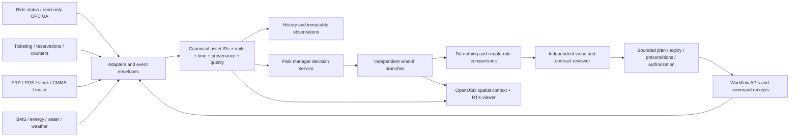

# From FOX factory manager to a park operations manager

Research checkpoint: 19 October 2026. This document distinguishes verified vendor capabilities, proposed park architecture, and the Aster Park implementation. All current park observations, decisions and actions are synthetic.

## What FOX contributes

NVIDIA describes FOX as a reference design for a factory manager that coordinates specialist agents and enterprise/machine APIs. The announcement names NemoClaw, AI-Q and Nemotron, with TAO for model-training workflows and Metropolis VSS for video understanding; an Omniverse operational twin is an optional visual surface. Its manufacturing improvement figures are customer projections/examples, not evidence of value in a theme park. The linked FOX availability page still presents a notification sign-up. This research did not establish a downloadable FOX package we can honestly claim to have installed. [NVIDIA FOX announcement](https://blogs.nvidia.com/blog/factory-operations-fox-blueprint-ai-brain/), [FOX notification page](https://www.nvidia.com/en-us/nvidia-factory-operations-blueprint-notify-me/).

Our interpretation is a **FOX-inspired park decision service**: observe → establish evidence → generate alternatives → simulate → compare with an ordinary operating rule → obtain an authorized decision → execute a bounded workflow → verify the outcome. A language model can coordinate and explain this loop. Numerical forecasts, qualifications and execution permissions need explicit services and contracts.

NemoClaw offers an agent reference stack with OpenShell isolation, configurable inference and network policy. OpenShell policy enforcement can limit agent capabilities, but it does not establish whether moving staff or shedding cooling is operationally sensible. The current Aster implementation does not install or claim NemoClaw/OpenShell; those are deployment options to evaluate separately. [NemoClaw overview](https://docs.nvidia.com/nemoclaw/latest/about/overview.html), [OpenShell enforcement guidance](https://docs.nvidia.com/openshell/latest/security/best-practices.html).

## Who benefits, and which decisions matter

The initial user is the duty operations manager of a regional park. Their useful question is: **“Given this disruption and the resources actually available, which response causes the least guest disruption without creating another problem?”** A screenshot of red rides is insufficient. The manager needs evidence, alternatives, expected delay, tradeoffs, an accountable action and feedback.

| Decision | Alternatives worth comparing | Outcome to measure | Reason to abstain |
| --- | --- | --- | --- |
| Coaster unexpectedly closes | Dispatch maintenance; adjust guest guidance; add qualified staff to an alternate attraction; change show timing | Service visits completed, backlog, guest-minutes waiting, displaced demand, staff cost | Unknown alternate capacity, stale ride status, no qualified reserve |
| Audience leaves a show | Stagger exits operationally; route guests; open a food service position; adjust nearby show start | Queue/route bottlenecks, walking delay, food stockouts | No pedestrian geometry, blocked accessible route, no verified capacity |
| Lunch queue grows | Staff the kitchen; replenish stock; redirect demand; offer a timed pickup window | Meals served, wait, stockouts, labor and waste | Stock missing, food qualification unavailable, delivery too late |
| Heatwave develops | Allocate guest-care reserve; increase hydration/shade provision; revise show schedule; protect cooling | Care demand versus capacity, water availability, comfort, guest disruption | Unknown heat limits or medical staffing; no thermal model |
| Power feeder is constrained | Reduce EV charging/noncritical loads; revise operations; dispatch an electrician | Capacity exceedance, energy, lost service and thermal comfort | Dependencies incomplete; protective or ride safety circuits implicated |
| Water flow changes unexpectedly | Inspect/dispatch; identify likely leak zone; schedule approved isolation; protect dependent services | Excess flow, service interruption, time to verified restoration | No valve topology, pressure/quality observations or authorized operator |
| Staffing is short | Use qualified reserve; alter breaks with supervisor approval; reduce an offered service | Minimum coverage, qualifications, overtime, guest impact | Donor team would fall below coverage; roster unreliable |
| Arrivals exceed expectations | Adjust admission windows, parking signs, shuttle frequency and queue staffing | Gate waits, parking spillback, crowding, denied/delayed entry | Contractual ticket commitments or transport capacity unavailable |

These are proposed decision families, not claims that the prototype models every consequence. The first implementation covers coarse queue/resource balances and exposes omissions rather than turning every action into a guaranteed improvement.

## The architecture



The aggregation layer is an operational data backbone, not a replacement ERP. Keep asset identity, source timestamps, units, quality, ownership and relationships consistent. ERP remains authoritative for stock/procurement; CMMS for work orders; workforce for qualifications; ride controllers for their own operating state. The decision service submits narrowly scoped requests and checks acknowledgements. An enterprise command accepted is not evidence of physical completion.

The OpenUSD stage supplies spatial identity and relationships. RTX lets an operator see which queue, feeder, route or building is implicated. Forecast lines and branch overlays need visible “simulation” labels and a fixed horizon; a future branch must not replace the live source of truth. Omniverse supplies application/rendering/simulation building blocks; it does not automatically solve queue demand, staff allocation or park economics. [Omniverse developer platform overview](https://docs.omniverse.nvidia.com/dev-overview/latest/platform-overview.html).

## Read and action API map

The endpoint names below are proposed adapter contracts, not claims that every vendor exposes identical endpoints. Discovery should record vendor/version, credentials, permissions, limits and ownership for each connection.

| System | Read contract | Bounded action contract | First integration |
| --- | --- | --- | --- |
| Ride SCADA / OEM system | Status, throughput, alarm code, inspection state, interlocks as observations | Request inspection or operator review; no direct ride restart from a manager agent | Read-only gateway; map OEM tags to asset IDs |
| Ticketing / reservation system | Arrival forecast, admission scans, booked windows, capacities | Propose capacity/window change under operator approval | Import aggregated time buckets; retain ticket commitments |
| People counters / video analytics | Zone count, direction, confidence, coverage and sample time | Create observation task; request operator verification | Aggregate counts only; camera health is part of quality |
| CMMS | Asset/work-order status, technician assignment, inspection completion | `create_work_order`, `assign_technician`, `request_inspection` | Dry-run work order and retry-safe vendor mapping |
| Workforce | Shift coverage, reserve availability, skills and expiry, breaks | `propose_assignment`, supervisor approval, acknowledged assignment | Qualified reserve first; donor minimum coverage explicit |
| ERP / POS / kitchen | Sale rate, stock, stock capacity, replenishment lead, available supply | `reserve_stock`, `create_replenishment_request`, `confirm_receipt` | Stock request is separate from receipt or physical delivery |
| BMS / energy / EV | Meter hierarchy, feeder capacities, flexible loads, temperatures, charging sessions | Approved noncritical setpoint/charging envelope with timeout and rollback | Monitoring first; comfort and service constraints required |
| Water / facilities | Flow hierarchy, pressure, quality, valve topology and work permits | `request_inspection`, approved isolation workflow | Read-only until topology and responsibility are established |
| Weather | Forecast issue time, horizon, temperature, wind/gusts, rain and uncertainty | No weather “write”; generate operational review tasks | External forecast plus local mast, with disagreement shown |
| GIS / BIM / OpenUSD | Asset prim mapping, paths, widths, barriers, accessible routes | Propose design alternatives or annotate issues | Immutable baseline scene plus separate scenario layers |
| Show / dispatch / signage | Timetable, audience, accessible routes, message state | Draft or approved message, schedule-change request | Preview exact affected signs and expiry |
| Finance / analytics | Labor, energy tariff, service margin, complaints and refunds | Approved accounting workflow only | Evaluate value after physical/service metrics are credible |

OPC UA supports information modeling, authentication and access controls; a protocol choice does not confer permission to operate a physical ride. The adapter should expose the smallest required read surface initially. [OPC Foundation overview](https://opcfoundation.org/about/opc-technologies/opc-ua/).

Maximo illustrates an enterprise system with REST integration for asset/work-order workflows. A real connector still needs the actual installation’s object structures, permissions and state transitions; “HTTP 200” alone does not prove that a technician completed a job. [IBM Maximo integration documentation](https://www.ibm.com/docs/en/SSLKT6_7.6.1.2/com.ibm.mif.doc/pdf_mif.pdf).

Two accessible external data directions are a weather adapter and an attraction-status research feed. Open-Meteo documents time-series weather fields. ThemeParks.wiki documents ride status, posted wait times and schedules; this is an external research source, not an operational command channel. Its published usage terms restrict onward data redistribution, so our public repository should retain synthetic fixtures rather than republish its raw feed. A missing attraction entry must remain unknown. A read-only [Open-Meteo preview](../external-weather-preview.md) is now implemented and independently labeled; attraction-status feeds remain unconnected. [Open-Meteo API](https://open-meteo.com/en/docs), [ThemeParks.wiki API](https://www.themeparks.wiki/api).

## What could be simulated

| Model family | Questions | Required inputs/calibration | Current status |
| --- | --- | --- | --- |
| Queue and service network | What if a ride closes, show ends or food demand peaks? | Arrival/service distributions, queue counts, guest choices, operational delays | Implemented as uncalibrated four-queue fluid model |
| Staff/shift allocation | Which qualified reserve should move, and when? | Qualification/shift/break data, reserve location, travel and donor coverage | Two-person reserve assumption and delay only |
| Inventory and kitchen | What if delivery is late or demand changes? | Sales/recipes, stock, shelf life, supply and lead times | One stock unit per food visit, bounded replenishment |
| Crowd movement and accessibility | Which routes bottleneck; does guidance displace congestion? | Walkable geometry, widths, barriers, counter data, behavior, mobility needs | Partial authored path graph and separate dining design query implemented; no density or pedestrian dynamics. Forecast arrival redistribution remains independent of geometry |
| Power and building thermal behavior | Can EV/HVAC demand change without harming service or comfort? | Electrical topology, tariffs, thermal envelope, controls, weather | Aggregate energy/capacity only; no comfort or network solution |
| Water network | Where is a leak; what does isolation interrupt? | Pipes/valves/pumps, pressure/flow/quality, demand | Incremental leak-volume arithmetic only |
| Ride mechanics and maintenance | Which degradation needs inspection; what fails under load? | OEM geometry, dynamics, loads, maintenance histories, validated failure models | Not implemented; dispatch never predicts repair |
| Arrivals, parking and transit | What if an event, road closure or shuttle delay changes arrival waves? | Road/parking network, ticket arrivals, schedules, vehicle and pedestrian flows | Not implemented |
| Weather exposure / noise / lighting | Where is shade needed; what if wind or rain changes operations? | Local weather, geometry, material/lighting data, operational rules | Scenario parameter only; no prediction/CFD |
| Commercial and experience outcomes | Do intervention costs justify service gains? | Reliable unit economics, complaints, accessibility outcomes, controlled comparisons | Cost proxy only; no revenue/ROI claims |
| Construction/design alternatives | Does a new route, queue pen or service point improve operations? | Same demand cases, buildable geometry, capacity and cost estimates | Baseline circulation audit and separate dining connection geometry/query implemented; no throughput or construction-feasibility proof |

Candidate specialist engines are external modules behind common input/output contracts. SUMO supports pedestrian and vehicle simulation, including JuPedSim integration; its results require a real connected network and demand assumptions. EnergyPlus models building energy behavior. EPANET models water distribution hydraulics and quality. They would complement the RTX view; none is installed or validated by the first planner. [SUMO pedestrian documentation](https://sumo.dlr.de/userdoc/Simulation/Pedestrians.html), [EnergyPlus essentials](https://energyplus.net/assets/nrel_custom/pdfs/pdfs_v24.2.0/EnergyPlusEssentials.pdf), [EPA EPANET](https://www.epa.gov/water-research/epanet).

## First implemented experiment

`backend/planning/` adds a pure planning model and an HTTP contract. The root application installs `install_planning_routes(app)`. `GET /api/planning/capabilities` publishes exact supported metrics and limitations. `POST /api/planning/simulate` accepts a disruption, 15–120 minute horizon in five-minute steps, common demand assumptions and optional scheduled alternatives. It reads one frozen canonical observation snapshot. Supplying `expected_state_revision` asks for that retained capture; unavailable revisions return 409 rather than silently planning from another state. Planning in recorded-view mode returns 409.

```json
{
  "scenario": "food_rush",
  "horizon_minutes": 60,
  "assumptions": {
    "arrival_multiplier": 1.0,
    "demand_uncertainty_pct": 20,
    "available_qualified_staff": 4,
    "routing_compliance_pct": 25
  }
}
```

Default branches are do nothing, a simple scenario-specific rule, and a coordinated response. The food example compares no action, replenishment, and replenishment plus two qualified reserve staff. Each uses the same initial state and low/central/high demand factors. These are sensitivity cases, not probability estimates. Results include trajectories, service visits served/backlogged, guest-minutes waiting, stockout duration, labor proxy, energy, feeder exceedance and incremental leak volume. Every branch reports conservation residuals and constraints.

Shortlisting uses feasible, nondominated alternatives across displayed metrics, avoiding an invented “AI score”; equal modeled outcomes prefer fewer actions. It is not a recommendation or automatic approval. Stale, unknown or uncertain input quality removes the shortlist while leaving diagnostic branches visible. Even a retained snapshot originally marked good is checked against each field's freshness limit at request time. A zero reserve pool makes a staffing alternative infeasible. Cooling load shedding during the heatwave scenario and unresolved end-of-horizon feeder overload are infeasible. Dispatch does not reopen the coaster. A repair and replenishment happen only after their assumed lead times.

Planning load shedding accepts `POWER_HUB` only and represents the explicitly documented park flexible-load group. Routing uses its actual `asset_id` as destination, transferring arrivals only from another open queue with a longer modeled wait; a closed destination is infeasible. A repeated action already present in canonical recent-action evidence is not credited again and makes that candidate infeasible. Reset/scenario audit boundaries clear this evidence. If the bounded 12-event history has no such boundary, the planner abstains because earlier active interventions may be missing.

The current planner is deliberately a different, explicit model from the original same-tick scenario comparison. It does not call `ParkSimulator.act`, modify mitigations, write work orders, advance telemetry or switch scenarios. The original live actions have their own illustrative rules; their instant effects must not be presented as validation of a forecast with travel and delivery delays.

## The execution boundary still matters

A decision-execution envelope needs an originating observation revision, exact action/target, relevant dependency values and quality, maximum age, authorization scope, expiry, idempotency key and expected acknowledgement type. A saved plan hash can supply rationale when a forecast actually informed the decision. Re-evaluate relevant preconditions at execution. Comparing the entire continually ticking state revision would reject every useful action; ignoring all revisions would permit stale decisions. Use a bounded relevant-state predicate and invalidate it when status, stock, staffing, source health or other decision inputs change materially.

The separate [maintenance workflow](../bounded-maintenance-workflow.md) now implements that boundary for immediate synthetic dispatch only. It supports direct current-incident proposals as well as saved comparisons, freezes relevant source observations, rechecks current conditions and reads back the durable work order. A historical comparison is context, never authority. Existing `/api/actions` remains the separate broader synthetic demonstration API with durable retry identity. Physical control should stay in its OEM/operator workflow. Creating a work order is a sensible first real-world action to pilot; directly commanding a ride restart is not part of this design.

## How to establish value over eight hours

Run repeated, timestamped trials with an API-only operator, a separate value reviewer and an implementation agent. Keep the operator blind to implementation internals when testing contracts. Compare the same state and demand cases against do nothing and a simple rule. Record no-op results, adverse cases and abstentions alongside apparent gains.

Useful negative controls include zero spare staff, zero routing compliance, a response arriving after the event, unavailable stock, normal low demand, stale/missing/conflicting observations and a changed scenario label with unchanged actual measurements. Check demand conservation, replay immutability, request bounds, forecast determinism and live-state nonmutation. A planner that always wins is a warning sign, not a success.

Screenshots should show actual app state, branch assumptions and unfavorable tradeoffs. Repository evidence should include source commit, model version, input revision, test case, response, decision rationale and test outcome. Separate elapsed test time from time spent building, authenticating or waiting for GPU capacity; do not describe an eight-hour test as complete before the recorded interval exists.

The first real pilot should select one decision with a measurable service outcome—food replenishment/staffing or ride-closure response—and run advisory-only against the operator’s existing procedure. Calibrate on history, test on withheld days, review errors, then consider a narrowly authorized workflow action. Expansion to better 3D assets is justified when geometry changes the answer, such as an accessible alternate route or a genuine crowd bottleneck.
