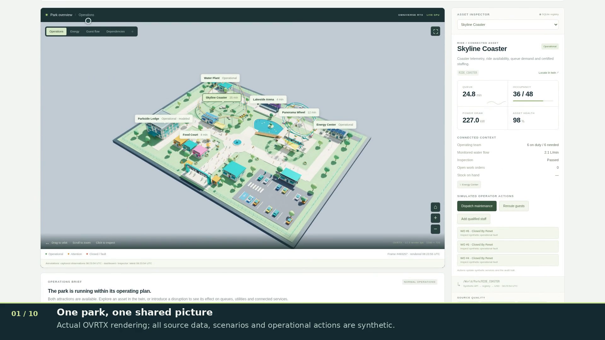

# Aster Park application presentation

[**Download / play the MP4**](https://raw.githubusercontent.com/mvovk911/theme-park-digital-twin/main/docs/video/aster-park-functionality-demo.mp4)
· [Chapter captions (SRT)](aster-park-functionality-demo.srt)
· [Capture and editing evidence](presentation-manifest.json)
· [Storyboard](storyboard.jpg) · [Playback validation](validation.json)

[](https://raw.githubusercontent.com/mvovk911/theme-park-digital-twin/main/docs/video/aster-park-functionality-demo.mp4)

**3 minutes 34 seconds** (214.1 s), 1920×1080 H.264 MP4, English captions,
no audio. Recorded on 16 October 2026 by operating the real application in
Chromium, connected to the existing NVIDIA L40 deployment. The browser displays
actual OVStage/OVRTX-rendered images; all operational data and actions are synthetic.
The video adds title cards, a visible pointer and a caption band beneath the UI.
The 12.6 MB file passed a complete decode check and sampled-frame visual inspection.
Application values and graphics were not replaced. The presentation runs at normal
speed; the initial page-loading interval and post-recording cleanup are excluded.

## Chapters

| Time | Demonstration |
|---|---|
| 00:00 | Project introduction |
| 00:07 | Connected park, live indicators and ride animation |
| 00:21 | Orbit, zoom and native geometry selection |
| 00:27 | Visible selection retries as the displayed context changes |
| 00:45 | Compare a ride closure, apply it, dispatch maintenance, inspect audit history |
| 01:17 | Power dependencies, flexible load shedding and water-leak repair |
| 01:47 | Show-surge rerouting, staffing and heatwave response |
| 02:12 | Food demand and ERP inventory replenishment |
| 02:27 | API architecture, raw source data, paused/stale/offline/live source modes |
| 03:03 | Recorded read-only closure view, retained ride pose and camera navigation |
| 03:16 | Return to live operations |
| 03:27 | Closing card and repository link |

All seven scenarios are demonstrated, including normal operation. Seven operator
actions cover six action families: maintenance dispatch, load shedding, leak
repair, guest rerouting, staffing and inventory replenishment.

## Evidence and limitations

The recorded deployment is commit
`19cee1e9a3dfaa3156fa4ba976d1ca21832d3242`, with scene SHA-256
`7e9f430e5302a9469e68fa649f2a1cbb0784bdf519a7a41421a96124b87a0c1c`.
Later repository commits add documentation and presentation tools; they are not
claimed as the deployed application. GPU source identity remained unchanged
throughout this capture. No browser page errors were reported. All recorded
scenario/action requests succeeded; native picking rejected five changing-context
requests with HTTP 409 before resolving food-court geometry on retry. These retries
remain visible and are explained by a caption. This is a current interaction
limitation, not a claim of seamless picking or production performance.

The underlying renderer reported 12.5 fps at capture preflight, with 1280×720 GPU
images. Chromium recorded the 1920×960 console at 25 fps; the presentation container
is 30 fps. Export resolution and frame rate do not imply native 1080p/30 rendering.
Chapter timing comes from monotonic browser automation timestamps and is
approximate relative to the first encoded video frame.

Historical inspection selected closure snapshot `19996`, including its recorded
ride pose and read-only state. Cleanup restored live view, the water source to
live mode, normal simulation, home camera and the operations layer. The existing
GPU instance was reused and left running; no additional GPU instance was allocated.

A first take was interrupted by an SSH tunnel failure and is excluded from the
presentation. The second take completed. Raw capture, failed take and intermediate
encodes stay in ignored local `runtime/presentation/`; the final MP4, subtitles,
poster and evidence are versioned here. No SDK binaries or credentials are included.

## Record another demonstration

Use an isolated presentation environment alongside the existing application:

```sh
python3 -m venv .venv-presentation
.venv-presentation/bin/python -m pip install -r requirements-presentation.txt
.venv-presentation/bin/python -m playwright install chromium
.venv-presentation/bin/python scripts/record_presentation.py --plan

# Connect your authenticated SSH tunnel to the running GPU gateway first.
env -u NODE_OPTIONS .venv-presentation/bin/python scripts/record_presentation.py \
  --url http://127.0.0.1:18765 \
  --output runtime/presentation/new-take

.venv-presentation/bin/python scripts/edit_presentation.py \
  runtime/presentation/new-take/capture-manifest.json \
  --output runtime/presentation/new-edit
```

Run on a dedicated demo session: the recorder changes shared synthetic scenarios,
connector modes, selected historical view and camera. It attempts to reset the demo
to live/normal/home on completion; it does not restore another user's prior state.
Both scripts require new output directories to preserve earlier captures.
The editor requires DejaVu Sans fonts at the standard Linux paths configured in
the script. `imageio-ffmpeg` supplies FFmpeg; a system `ffprobe` is optional.

For an editorial caption change, copy the capture manifest, adjust its `chapters`
array and resolve its `video` path relative to the copied manifest. Use actual
capture timestamps. The published version adds the selection-retry chapter at
raw second 22.2, aligns the return-to-live caption with its successful response
at second 191.147, and ends at content second 201.970, within the measured raw
duration of 203.440 seconds. Inspect the output before publishing it.
