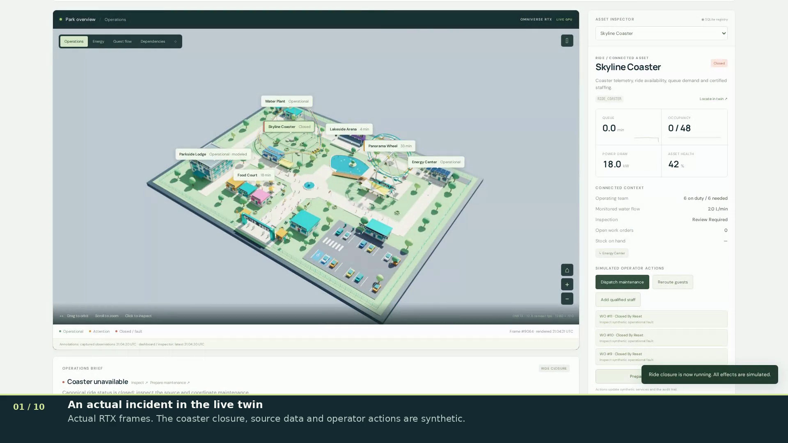

# Incident workflow and dining design — short GPU application update

[**Watch / download the 88-second MP4**](https://raw.githubusercontent.com/mvovk911/theme-park-digital-twin/main/docs/video/fox-update/aster-park-fox-update.mp4)
· [Captions](aster-park-fox-update.srt)
· [Storyboard](storyboard.jpg)
· [Capture and editing evidence](edit-manifest.json)
· [Full decode](verification.json)
· [Sampled visual review](visual-review.json)

**87.77 seconds**, 1920×1080 H.264, 30 fps container, English captions and no audio.
Recorded on 19 October 2026 by operating the actual Chromium application connected
to an NVIDIA L40 running OVStage/OVRTX. Operational sources and work orders are
synthetic. The dining images are separate static native captures displayed by the
application; they are not changes to the live camera or scene.

| Approximate time | Demonstration |
|---|---|
| 00:00 | Actual native park view and a synthetic coaster closure |
| 00:09 | Prepare the current incident without a saved forecast |
| 00:18 | Inspect frozen status, inspection and open-order observations |
| 00:29 | Explicitly execute and inspect the matching work-order receipt/readback |
| 00:42 | Return to the live view: one open order, ride still closed |
| 00:49 | Compare baseline and dining design in the authored path graph |
| 00:57 | Inspect matched native before/after closeups |
| 01:05 | Close the design connector in a read-only query; no route remains |
| 01:14 | Apply the step-free filter; the entrance threshold remains unresolved |
| 01:22 | Export exact query evidence and review the limits |

The design route is 40.852 m to the new plaza landing, with 34.04 seconds at an
assumed 1.2 m/s. An unreachable baseline does not support a percentage travel-time
saving. Neither route evidence nor the proposed connection establishes capacity,
certified accessibility or a queue-forecast benefit.

## Source and acceptance

Both gateway and renderer identify verified application commit
`afa84a17d6cc282ed2aa4003743d62770644ea48` at the beginning and end. The actual
renderer provides 1280×720 images at approximately 12.5 fps. Chromium recorded the
1920×960 browser at 25 fps; the export's dimensions and rate do not imply native
1080p/30 RTX rendering. The capture used Playwright 1.58.0/Chromium 145 on the GPU
host; CPU editing used Pillow 12.3.0, imageio-ffmpeg 0.6.0 and FFmpeg 7.0.2.

The take has no recorded page, request, observation or finalization errors. It
restored live mode, normal synthetic state, home camera and the operations layer,
then read back live/normal. The reset closes the demonstration order; its accepted
receipt remains historical evidence.

The complete output decoded successfully: **2,633 frames**. A frame from every
chapter, plus full-size receipt and before/after frames, was visually inspected.
All captions fit beneath the viewport. This is full automated decoding and sampled
visual acceptance, not a claim of watching every encoded frame. The original
application pixels were not replaced; the only overlay is the caption band below
the browser. Playback remains at normal speed.

Initial setup is trimmed by 2.137 seconds. The capture's monotonic endpoint was
90.138 seconds, but the raw container measured 89.92 seconds. The strict first edit
correctly refused that mismatch. An explicit bounded trim excludes the unavailable
0.218-second tail; it does not pad, repeat or accelerate footage. The requested
87.783-second edit quantizes to the measured 87.77-second export. Capture-to-first-
encoded-frame alignment and chapter times remain approximate.

The original take and failed edit log remain in project runtime storage. The
[reproducible capture/edit procedure](../fox-update-plan.md) records the exact trim
policy. The edit manifest embeds the unchanged capture evidence and hashes of the
raw file, tools and exported artifacts. Source hashes identify bytes; they do not
authenticate an external operational outcome.

MP4 SHA256: `a0cae5bad1ef3b59da8ebd4b223460c38044cd27bc354d751c07c2279352f303`.

The [original 3½-minute presentation](../README.md) covers navigation, all seven
scenarios, utilities, source degradation and replay. This update adds the newer
bounded workflow and spatial comparison; it does not replace the original video.
